[Deutsche Version](README.md)

<picture>
  <source media="(prefers-color-scheme: dark)" srcset="assets/readme/banner-dark.svg">
  
</picture>

<h3 align="center">BLECHTRIBE: new firmware for your Electribe 2. Free.</h3>

<p align="center">BLECHTRIBE is its own firmware upgrade for the Electribe 2. It runs directly on Korg's original firmware 2.02 and is not a Hacktribe variant. You do not need Hacktribe. Hacktribe is a separate project, you can use it on top, but you do not have to.</p>

<p align="center">
  <a href="https://github.com/KuhlerBuhler/kuhlers-gelumpe/releases/latest"></a>
</p>

<p align="center">No code to edit. Click the button, download the app for your computer and get started.</p>

## Contents

- [Frequently asked questions](#frequently-asked-questions)
- [Install BLECHTRIBE on your Electribe](#install-blechtribe-on-your-electribe)
- [Which firmware does what?](#which-firmware-does-what)
- [What BLECHTRIBE can do](#what-blechtribe-can-do)
- [Before and after](#before-and-after)
- [Patch the firmware](#patch-the-firmware)
- [Get the app](#get-the-app)
- [Plugins](#plugins)
- [The emulator](#the-emulator)
- [Safety](#safety-before-you-put-anything-on-the-device)
- [Contributing](#contributing)

## Frequently asked questions

- **Does it cost anything?** No. If you like it, a [donation](https://www.paypal.me/kuhlerbuhler) is welcome.
- **Is it safe?** The app checks the new firmware in the emulator before making it available. That catches many errors, but it cannot guarantee the result on every real device. Back up your original firmware and your data first. Hold **EXIT while powering on** (the [emergency switch](docs/glossary.en.md#notschalter)) to start without BLECHTRIBE and reinstall your original firmware.
- **Do I need a computer?** Yes, once to patch the file. You can use the Electribe without the computer afterwards.
- **Are samples included?** No. BLECHTRIBE contains no samples. Your own samples stay on your card. On the first start, the Electribe offers to take over your existing sample folder.
- **Does it work on the blue Electribe?** Yes, with fewer features. See the table below.
- **Blue Electribe: where are my exports?** In `KORG/blechtribe/`, no longer in `KORG/electribe/`. On the first start, the Electribe offers to copy `KORG/electribe/` there.
- **Do I need [Hacktribe](docs/glossary.en.md#hacktribe)?** No. BLECHTRIBE runs directly on Korg's original. If you already run Hacktribe, you can install BLECHTRIBE on top of it and keep Hacktribe's own features. Patching Korg's original firmware does not add Hacktribe's features.
- **How do I make my own effects?** Open the [**Baukasten**](docs/glossary.en.md#baukasten) in the app. Take a ready effect or build one from blocks, with names and real units. The export puts them on the SD card (red and blue), single ones also go live over USB (red only). Both need BLECHTRIBE. On the blue this is so far checked in the emulator only. An `.e2fx` file opens under BLECHTRIBE -> Baukasten -> Meine Effekte -> ".e2fx-Datei öffnen", or with a loaded firmware under BLECHTRIBE -> Presets -> "Preset-Datei laden".
- **Windows: the app does not find my Electribe, although its MIDI ports are listed.** Korg's own USB-MIDI driver is probably installed; the Electribe's replies do not come through it. Remove it in Device Manager (the Electribe, "Uninstall device", with the driver) and restart Windows. Windows' own driver is enough. If the KORG Driver Setup Utility then offers to reinstall it, close it. The MIDI report in the settings says so too.
- **I have an idea for the app or firmware.** [Write it down here](https://github.com/KuhlerBuhler/kuhlers-gelumpe/issues/new?template=idea.yml). You need a GitHub account.

## Install BLECHTRIBE on your Electribe

You need a computer (Mac, Windows or Linux) and an SD card reader, once for a few minutes.

1. **Download the app** with the button above. On the release page, find "Assets": `.dmg` for Mac, `.exe` for Windows, `.AppImage` or `.deb` for Linux. macOS blocks the downloaded app at first because it is not signed by Apple. See [Get the app](#get-the-app) for how to allow it.
2. **Put the Electribe's SD card in your computer.**
3. **Open the app**, choose **Firmware Patcher** and drop your [`SYSTEM.VSB`](docs/glossary.en.md#vsb) from the card onto the page. It is in `KORG/electribe sampler/System/` (red original) or `KORG/electribe/System/` (blue Electribe). Only if you use Hacktribe, it is in `KORG/hacktribe/System/`. Without the file, the app downloads Korg's original itself once you accept Korg's licence.
4. **Wait for the checks to finish**, then save the new file. The app tells you where to put it on the card.
5. **Put the card back in the Electribe**, turn it on and start the firmware update. The app shows you which buttons to press.

If something goes wrong, the app tells you what happened. If you are still stuck, include a photo of the message when asking for help.

## Which firmware does what?

| | Red sampler original | Blue synth original | Sampler with Hacktribe | **BLECHTRIBE** red | **BLECHTRIBE** blue | **BLECHTRIBE** with Hacktribe |
|---|:-:|:-:|:-:|:-:|:-:|:-:|
| Record your own samples | ✅ | ➖ | ✅ | ✅ | ➖ | ✅ |
| Load your own samples (blue: from the sample file as group `[User]`, up to 64) | ✅ | ➖ | ✅ | ✅ | ✅ | ✅ |
| Oscillators as in Hacktribe (Dual, Oct, Chip, ...), rebuilt in BLECHTRIBE | ❌ | ❌ | ✅ | ✅ | ❌ | ✅ |
| Inserts as in Hacktribe (Lag, KP2 Comp, drive filters, delays), rebuilt in BLECHTRIBE | ❌ | ❌ | ✅ | ✅ | ❌ | ✅ |
| Master effects as in Hacktribe (Big Hall, Plate Reverb, Tap Delay Sync, Tube Drive), rebuilt in BLECHTRIBE | ❌ | ❌ | ✅ | ✅ | ❌ | ✅ |
| Extra grooves and scales as in Hacktribe (62 grooves, 70 scales), in BLECHTRIBE with its own grooves and chords | ❌ | ❌ | ✅ | ✅ | ❌ | ✅ |
| Import/export effects and grooves through Hacktribe menus | ❌ | ❌ | ✅ | ❌ | ❌ | ✅ |
| Custom INIT pattern | ❌ | ❌ | ✅ | ✅ | ✅ | ✅ |
| Hacktribe SysEx (for the Hacktribe editor) | ❌ | ❌ | ✅ | ❌ | ❌ | ✅ |
| Own USB commands for the app (card, plugins, RAM; on the blue RAM is read-only) | ❌ | ❌ | ❌ | ✅ | ✅ | ✅ |
| Use the red sampler's unchanged factory sample bank | ✅ | ➖ | ❌ | ✅ | ➖ | ❌ |
| Custom start image, fonts and shutdown image | ❌ | ❌ | ❌ | ✅ | ✅ | ✅ |
| Loading animation with progress | ❌ | ➖ | ❌ | ✅ | ➖ | ✅ |
| Draw your own start image on the device | ❌ | ❌ | ❌ | ✅ | ✅ | ✅ |
| Synth filters (MS20, Acid, ...) | ❌ | ✅ | ✅ | ✅ | ✅ | ✅ |
| Edit effects freely in the app | ❌ | ❌ | ✅ | ✅ | ❌ | ✅ |
| 128 slots for custom effects | ❌ | ❌ | ❌ | ✅ | ✅ | ✅ |
| Second master effect (MFX 2) | ❌ | ❌ | ❌ | ✅ | ✅ | ✅ |
| BEAT 8: eighth-note steps, patterns twice as long | ❌ | ❌ | ❌ | ✅ | ✅ | ✅ |
| TOUCH SCALE RANGE 0: X plays the key note only | ❌ | ❌ | ❌ | ✅ | ✅ | ✅ |
| Import samples onto factory slots | ❌ | ➖ | ❌ | ✅ | ➖ | ✅ |
| Plugins and games (Snake, Tetris, ...) | ❌ | ❌ | ❌ | ✅ | ✅ | ✅ |
| Pad and LED colours | ❌ | ❌ | ❌ | ✅ | ✅ | ✅ |
| Confirm before changing patterns | ❌ | ❌ | ❌ | ✅ | ✅ | ✅ |
| Sync groups (patterns play as one) | ❌ | ❌ | ❌ | ✅ | ✅ | ✅ |
| Quick save (EXIT + WRITE), reset a part (EXIT + Pad) | ❌ | ❌ | ❌ | ✅ | ✅ | ✅ |
| End every sound (hold STOP) | ❌ | ❌ | ❌ | ✅ | ✅ | ✅ |
| KEY from the pads (KEYBOARD + Pad) | ❌ | ❌ | ❌ | ✅ | ✅ | ✅ |
| Filter off and on (SHIFT + filter key) | ❌ | ❌ | ❌ | ✅ | ✅ | ✅ |
| Settings save themselves when you leave the menu (AUTO SAVE) | ❌ | ❌ | ❌ | ✅ | ✅ | ✅ |
| Highlight chord pads in colour | ❌ | ❌ | ❌ | ✅ | ✅ | ✅ |
| Toggle motion sequences on/off | ❌ | ❌ | ❌ | ✅ | ✅ | ✅ |
| Note assistant | ❌ | ❌ | ❌ | ✅ | ✅ | ✅ |
| Dice (random melodies) | ❌ | ❌ | ❌ | ✅ | ✅ | ✅ |
| Clear messages for broken samples | ❌ | ➖ | ❌ | ✅ | ✅ | ✅ |
| Tube curve on the output (TUBE) | ❌ | ❌ | ❌ | ✅ | ✅ | ✅ |
| Device menus in German (only with the checkbox in the app's patcher, not in the ready-made files of the release) | ❌ | ❌ | ❌ | ✅ | ✅ | ✅ |
| Doom | ❌ | ❌ | ❌ | ✅ | ❌ | ✅ |
| Update over USB from the app | ❌ | ❌ | ❌ | ✅ | ✅ | ✅ |

➖ means: does not apply to the synth, it records nothing and has no factory samples.

Hacktribe is a separate project by someone else. BLECHTRIBE does not need it, but can also be installed on a Hacktribe file. Applying BLECHTRIBE to a Korg original does not add Hacktribe's features. The exception is three rebuilds that run on the red BLECHTRIBE without Hacktribe: the Hacktribe-style oscillators on the free display slots 422 to 497, always on, no switch, the 11 inserts on IFX slots 39 to 49 and the 4 master effects on MFX slots 33 to 36. The columns "BLECHTRIBE red" and "BLECHTRIBE with Hacktribe" are the same product, only the base file differs. The blue BLECHTRIBE column describes the Synth set on Korg 2.02. Hacktribe itself supports both hardware types.

**Hacktribe trade-offs:**

| Drawback | What it means for you |
|---|---|
| Oscillators replace the factory sample bank | Your own samples use slots 501 to 999. Factory samples need conversion before loading into the user bank. Only BLECHTRIBE 1.5 also allows an import from slot 275 with Hacktribe. |
| Your samples are gone afterwards | Hacktribe reads its own folder, and its how-to says to delete `e2sSample.all`. Back up the `Sample` folder of your current firmware first (`KORG/electribe sampler/` or `KORG/blechtribe/`); the app asks you to confirm that with a checkbox. Already happened? The Blechy page has the case "I installed Hacktribe by accident". |
| Existing patterns may sound different | Oscillator and effect assignments change. Listen to your patterns after switching and reassign sounds where needed. |
| An extra firmware change | Starting from Korg's original requires a suitable Hacktribe file first. BLECHTRIBE also works directly on Korg's original, which is the normal case. |

Features and migration: [Hacktribe](https://github.com/bangcorrupt/hacktribe), [oscillators](https://github.com/bangcorrupt/hacktribe/wiki/Features#oscillators), [factory samples](https://github.com/bangcorrupt/hacktribe/wiki/How-To#factory-samples) and [FAQ](https://github.com/bangcorrupt/hacktribe/wiki/FAQ).

## What BLECHTRIBE can do

The main things in one sentence each. The table above shows which Electribe can do what. "Checked in the emulator only" means: not yet on a real device.

**Samples**

- **Sample swap (new in 1.5, red):** very large sample libraries (over 25 MB) fit on the red Electribe. Only the samples the playing pattern needs are kept in memory, the rest stays on the card and is loaded when you switch patterns. Checked in the emulator, on a device only in part.
- **Sample category (new in 1.5, red):** in DATA UTILITY > SAMPLE EDIT you set one of 18 categories (kick, snare ...) for each sample, so SHIFT + OSC wheel jumps to it. The category reaches the card with EXPORT ALL SAMPLE. Checked in the emulator only.
- **Samples on factory slots (new in 1.5, red):** IMPORT SAMPLE can now replace a factory sample: any slot from 19 up works as the target (from 275 with Hacktribe), not only 501 to 999.
- **Your own samples on the blue (new in 1.5):** at power-on the blue Electribe loads your samples from the sample file on the card, and they show up as the oscillator group `[User]`. Up to 64 samples, about one minute in total. Add them on the Samples page of the app (switch to blue), or take a WAV on the device with DATA UTILITY > IMPORT SAMPLE, it then plays right away. DATA UTILITY > SAMPLE EDIT sets start, loop, end, tune, level and the new REVERSE. Checked in the emulator only.
- **Stereo samples:** a stereo sample takes only one pad, so the pad next to it plays its own sample again (red, can be turned off under BLECH > FEATURES > STEREO 1 PAD).
- **Samples in the app:** on the Samples page you see the samples on your Electribe, add WAV files and remove samples, either with a card reader or directly over the USB cable.

**Patterns**

- **Sync groups:** several patterns with the same group number play as one, for more than 128 steps. Long samples keep ringing across the switch, and live changes such as pitch or modulation carry over to the next pattern.
- **Look at a pattern while one plays:** while playing, turning the wheel shows the next pattern with its tempo. You can play it and pull single parts into the running pattern before you confirm the switch with MENU.
- **Patterns folder (new in 1.5, red):** patterns are exported and imported in `KORG/blechtribe/Patterns/`. If the backup `electribe_sampler_allpattern.e2sallpat` is in there, the Electribe loads it at every start. After saving on the device, export again, otherwise the next start brings back the state of the file. Checked in the emulator only.
- **MFX 2:** each of the two master effects remembers its own MFX HOLD state and pad position (new in 1.5, red).

**Effects**

- **Ready effects:** the Baukasten comes with ready effects, for example Bounce Gate, Hardtekk Kick, Warm Drive, Bit Grinder, Glue Comp and ULTRA LOUD, plus modulations like Kick Drop. The list is in [docs/effekt-katalog.md](docs/effekt-katalog.md) (German).
- **Your own effects on the blue (new in 1.5):** the blue Electribe also gets the effect catalog, 128 slots for your own effects and the export to the card. Editing live over USB does not work there yet. Checked in the emulator only.

**Display and power**

- **IDLE SAVE (new in 1.5):** dims the display and LEDs when nobody is playing (default: battery only).
- **BATTERY % (new in 1.5):** shows the charge as a number when you play on battery and BATTERY TYPE in the global settings is set to Alkali.
- **LOAD METER:** shows the processor load at the top of the display (off by default).
- **KNOB LEDS:** turns off the lights behind the knobs.
- **Start image and loading animation (new in 1.5, red):** you put them as files into `KORG/blechtribe/Media/` on the card, without rebuilding the firmware. The Image Viewer app shows all pictures there.

**App and plugins**

- **App:** the app comes in 11 languages. It connects to the Electribe by itself, can save the finished firmware straight to the SD card, and the Blechy page answers questions and leads you back if the device does not start.
- **Plugins:** plugins can write steps, send MIDI, read the output level, intercept pads and keys, use timers and store 16 files each on the card.

## Before and after

The normal Electribe is on the left, BLECHTRIBE on the right. The animations use our own firmware graphics; the loading finale is held longer in this preview. Normal shutdown is a schematic illustration using our own font.

| Normal | BLECHTRIBE |
|:-:|:-:|
| 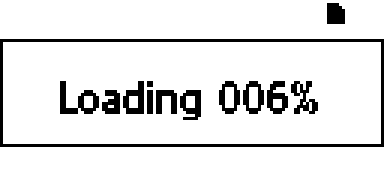 |  |
| 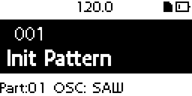 | 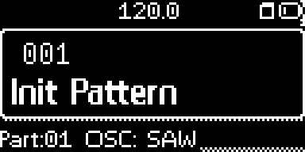 |
| 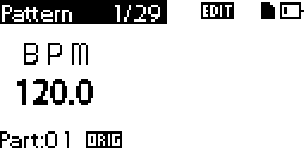 | 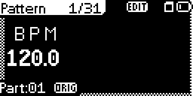 |
| 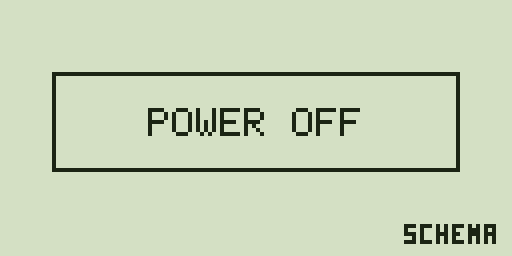 |  |

## Patch the firmware

Open **Firmware Patcher**, drop your own `SYSTEM.VSB` (Korg's original 2.02 for sampler or synth, or Hacktribe 2.02; without your own file the app downloads Korg's original after you accept Korg's licence) onto the page and choose the patches. Before downloading, the emulator boots the result and checks the main screen, update prompt, start modes and emergency switch. This takes a few minutes; the page shows which group is running. It then explains how to install the file on the device. All patches and their limits are in [docs/patcher.en.md](docs/patcher.en.md). To patch without the app, use `BLECH.patch` or the matching `.bsdiff` from the release as described there.

On the sampler, BLECHTRIBE includes the BLECH menu, plugins, display and LED colours, pattern confirmation, sync groups, TAP Motion, a note assistant in KEYBOARD mode, KEYBOARD + Pad to set the KEY, SHIFT + filter key to turn the filter off and on, random melodies (SHIFT + PART ERASE), EXIT + WRITE to save, EXIT + Pad to reset a part's sound (also while playing), STOP held to end every sound, pink chord steps, migration of your existing sample folder, [Blechy](docs/glossary.en.md#blechy), loading progress, clearer sample errors, a tube curve on the output (BLECH > FEATURES > TUBE), menus in German (checkbox in the app's patcher) and Doom (SHIFT + TAP at power-on, the app writes both files to the card over USB; [licence](docs/doom-lizenz.md), German).

## For tinkerers

GELUMPE is the app behind BLECHTRIBE: an editor, emulator and firmware patcher for the Electribe 2. The blue Electribe has a separate Synth set; its tested scope and remaining limits are in the [Synth measurement](docs/messungen/2026-10-16-blech-synth.md).

## Who I am

I am Kuhler Buhler, aka Pascal, a software developer and live act. After installing Hacktribe I noticed you could edit the MFX and IFX presets. Then I spent a few months in a development frenzy, and this is what came out of it. BLECHTRIBE is its own patch on Korg's original, not a Hacktribe offshoot. Korg left so much of the Electribe 2's potential unused that, with BLECHTRIBE, I practically built the Electribe 3 that never happened.

If this is useful to you, a [donation via PayPal](https://www.paypal.me/kuhlerbuhler) is welcome.

## What you can do

GELUMPE runs as an app or in the browser and works with the Electribe 2 on firmware 2.02: the red sampler (Korg's original, optionally also Hacktribe) and the blue synth (Korg's original). You do not need Hacktribe. You can run the firmware in the emulator, patch your own `SYSTEM.VSB`, write plugins that run on the Electribe, build your own effects in the Baukasten and send patterns over Web MIDI.

Plugins go on the card in the folder `KORG/blechtribe/Plugin/`, or with the device connected the button "Aufs Gerät" sends them over USB. In the Baukasten you build effects and modulations with real units instead of bytes and pass them on as `.e2fx` files or export them as one file for the card. Before anything goes to the device, a [linter](docs/glossary.en.md#linter) with rules checked against the real device and the emulator judge whether the Electribe is likely to accept it. The red sampler's effect editor and RAM writes require BLECHTRIBE's USB commands (or Hacktribe). An unrecognised firmware or device is read only.

**No firmware or samples ship with this.** Load your own `SYSTEM.VSB`. It stays on your computer and is not uploaded to a server.

## Preview

The app in dark mode. The emulator is shown without firmware, so its display stays black.

| | |
|---|---|
| 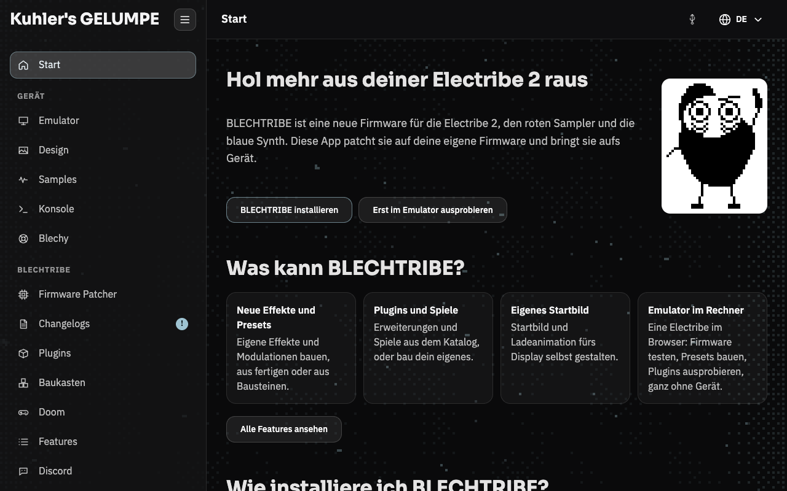 | 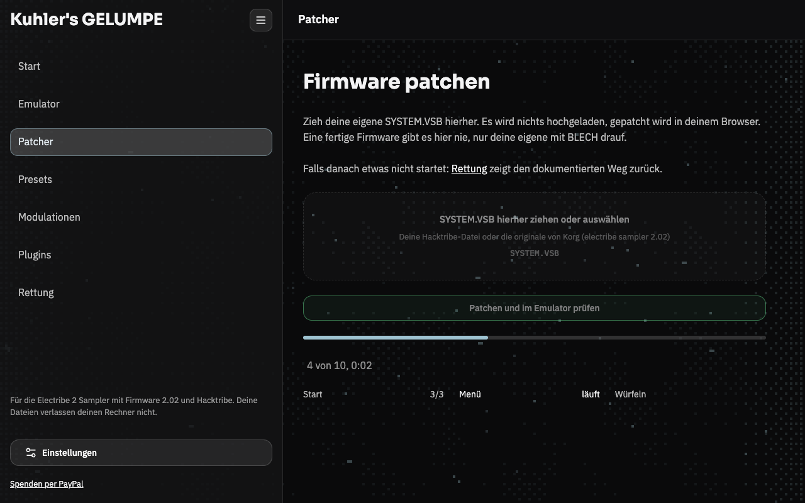 |
| Start | Patcher |
| 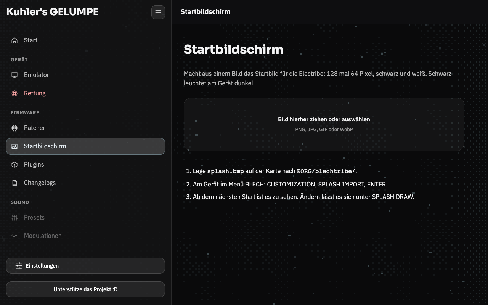 | 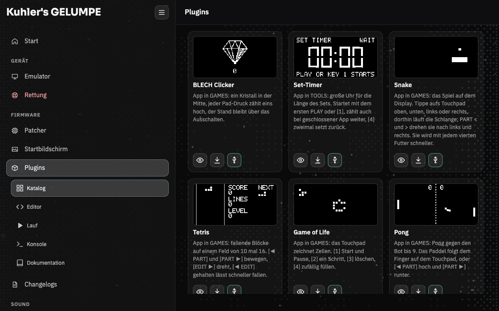 |
| Draw your own start screen | Plugin catalog |
| 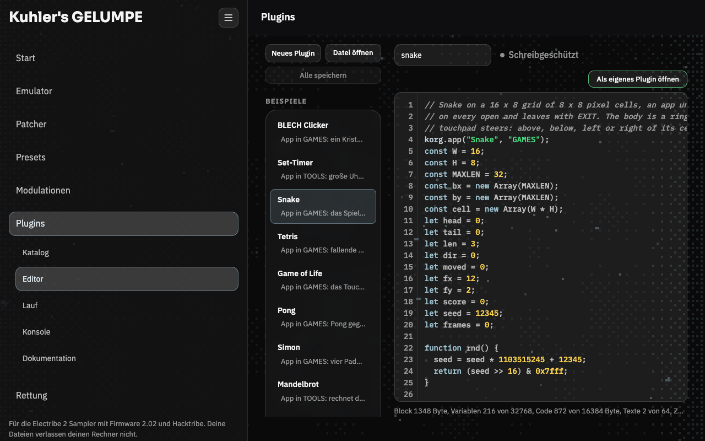 | 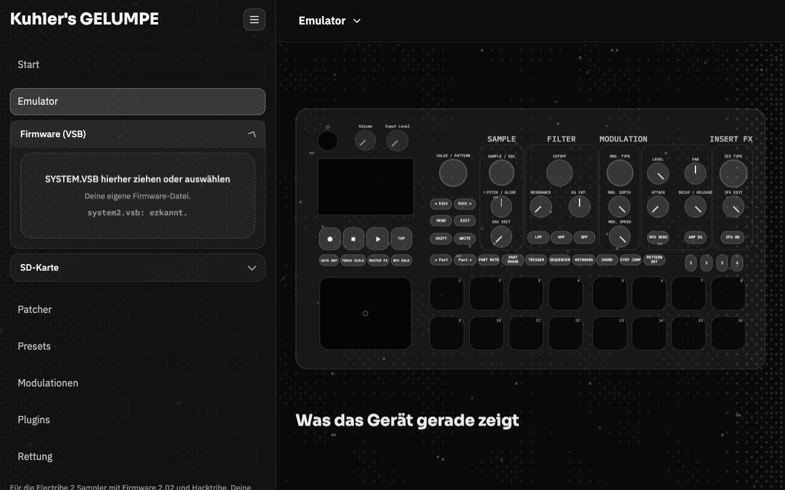 |
| Plugin editor | Emulator |

## Get the app

The Releases page of this repository has the app for macOS (Apple Silicon and Intel, one `.dmg` each), Windows
(`.exe`) and Linux (`.AppImage`, `.deb`). The app starts the emulator service itself and stops it when
you close it. The emulator's card and flash live in `~/.gelumpe`. On start and every few hours the app
checks for a newer release and shows "Neue Version verfügbar" at the top; a click downloads the file for your system into the Downloads folder and starts the installation (on failure the release page opens).

**The app is not signed.** On macOS the system blocks the downloaded app. Release it once:

```bash
xattr -dr com.apple.quarantine "/Applications/Kuhlers GELUMPE.app"
```

On Windows, SmartScreen shows a warning: "More info", then "Run anyway". The `-setup.exe` carries
WebView2 and installs it when it is missing (e.g. on Windows 10), without needing the internet.

## Quick start from source

**In the browser.** You need Node.js 20 or later, and for the emulator Python 3.10 or later.

```bash
npm ci
npm run setup:emu   # once: Python environment with Unicorn for the emulator
npm start           # page and emulator together
```

`npm start` prints the address (by default `http://127.0.0.1:8737/`), open it in your browser. Without
the emulator `npm run serve` is enough and `setup:emu` is not needed. To talk to the device you need
Chrome or Edge on a desktop computer: the page uses Web MIDI with [SysEx](docs/glossary.en.md#sysex), which Safari does not have.

**In a container.** Without Node and Python on the machine the same pair runs in Docker:

```bash
mkdir SD
docker compose up --build
```

Then open http://localhost:8737/. The emulator's card lives in the folder `SD`, and a new container keeps
it. How to take the image a release published instead of building one:
[development](docs/development.md#im-container) (German).

The desktop app uses native MIDI ports on macOS and Linux. It needs no additional browser
or separately installed MIDI helper. On Windows the app keeps its existing Web MIDI path.

**Build the app yourself** (Tauri v2). Once: Node 20+, Python 3.10+, Rust via `rustup` and
`cargo install tauri-cli --version "^2" --locked`. Plus per system: on macOS the Xcode Command Line
Tools, on Windows the Visual Studio Build Tools with "Desktop development with C++", on Linux
`libwebkit2gtk-4.1-dev libgtk-3-dev libayatana-appindicator3-dev librsvg2-dev libssl-dev libxdo-dev
patchelf python3-venv libasound2-dev`.

```bash
npm ci
npm run app:build -- --bundles dmg            # macOS
npm run app:build -- --bundles nsis           # Windows
npm run app:build -- --bundles appimage,deb   # Linux
```

The build compiles the page, freezes the emulator service into a [sidecar](docs/glossary.en.md#sidecar) with PyInstaller
(`npm run build:sidecar` does just that) and packs the app. The result lands in
`src-tauri/target/release/bundle/`: `dmg/*.dmg` (macOS), `nsis/*-setup.exe` (Windows),
`appimage/*.AppImage` and `deb/*.deb` (Linux). Each system builds its own, cross-building does not
work. More (Intel Mac, Windows on ARM): [development](docs/development.md) (German).

## Plugins

A plugin gives the Electribe a new function. You put it on the device through the SD card, in the folder
`KORG/blechtribe/Plugin/`. The folder is called `Plugin`, singular, not "Plugins", and it is the same on the
red and the blue Electribe. The firmware does not create it, you do. With the device connected you can skip
the card: in the Plugins area the button "Aufs Gerät" writes the plugin there over USB, then on the device
Menü -> BLECH -> PLUGINS. With only the card in the computer, the button reads "Auf die Karte" and writes the plugin
straight onto the card. The code is a subset of JavaScript, the editor compiles it to bytecode for a
small VM in the firmware, and an error switches the plugin off without disturbing the Electribe.
Language, events and functions: [docs/plugins.en.md](docs/plugins.en.md).
The catalog has ready plugins: BLECH Clicker, Set-Timer, Snake, Tetris, Game of Life, Pong, Simon, Mandelbrot,
GIF Player, Image Viewer, BPM Glide, Lauflicht, Pulsieren, STOP-Takt, Momentary Mute, Gate Hold, Step Copy, 303Pattern,
EUCLID FLOW, LIVE RELOAD, RANDOM SLOT, Better Accent, Easy Slides, Pad Finger, Blechy Run, System Info, VU Meter, Spettro,
MIDI Echo and Motion Clear.

## The emulator

The emulator runs the real firmware as a local service, and the page shows an operable device with a
virtual SD card. It produces no sound and does not replace listening, but you can try everything before a
device sees it. More: [docs/emulator.md](docs/emulator.md) (German). The firmware's key combinations are in
[docs/tastenkombinationen.md](docs/tastenkombinationen.md) (German).

## Safety: before you put anything on the device

A wrong write or a faulty firmware can hang the device. So:

- **Emergency switch:** hold EXIT while powering on. The firmware then runs without patches, and DATA
  UTILITY, SOFTWARE UPDATE lets you install a different firmware. This only applies to that one start.
- **Back up before you change anything:** the SD card (samples, patterns, the original `SYSTEM.VSB`) and
  the global settings. Powering off, WRITE and, with AUTO SAVE, leaving GLOBAL PARAMETERS save whatever
  is in RAM, so do not power off if something looks wrong.
- **Way back:** put the saved original `SYSTEM.VSB` back. How that was rehearsed is in
  [docs/messungen/2026-10-10-rueckweg-geuebt.md](docs/messungen/2026-10-10-rueckweg-geuebt.md).
- **Back to Korg's original, also from the blue:** step by step in
  [docs/original-zurueck.en.md](docs/original-zurueck.en.md) and as a case on the Blechy page.
- **If the device no longer starts:** the "Blechy" page in the editor asks what you see and
  walks you back along the documented recovery. The [bootloader](docs/glossary.en.md#bootloader) is never
  touched, beyond it only [JTAG](docs/glossary.en.md#jtag) helps ([docs/rettung.md](docs/rettung.md)).
- **Test it yourself:** the [device tests](docs/geraetetests/README.md) describe how to repeat BLECHTRIBE and
  the card functions on your own device, with a warning, prerequisites, a backup and the way back.

The [linter](docs/glossary.en.md#linter) checks known memory regions, message format and documented failure cases. The emulator runs
the firmware's real ARM code, but the [DSP](docs/glossary.en.md#dsp) only as a stand-in: it makes no sound, and it only imitates the
panel and the timing. Whether something sounds good, only your ears can say. Much is so far checked in
the emulator only, not yet on a real device. Details: [docs/linter.md](docs/linter.md),
[docs/emulator.md](docs/emulator.md) (German).

## Documentation

[docs/README.md](docs/README.md) is the index: plugins, patcher, emulator, the device map, the
measurements on the device, ideas and background. For working on the code:
[docs/development.md](docs/development.md). The docs are in German, except the pages on
[plugins](docs/plugins.en.md), the [patcher](docs/patcher.en.md), [going back to the original](docs/original-zurueck.en.md), the [glossary](docs/glossary.en.md) and the docs index ([docs/README.en.md](docs/README.en.md)), which also exist in English.

AI agents also work on this project. The rules for them are in [AGENTS.md](AGENTS.md).

## Contributing

Pull requests go to `develop`, not to `main`. The rules are in [CONTRIBUTING.md](CONTRIBUTING.md); the most important
one: no Korg data in the repository, ever. A check closes a pull request that carries any. If you find something that
can damage a device, report it privately ([SECURITY.md](SECURITY.md)).

## Licence

AGPL-3.0, see [`LICENSE`](LICENSE). Where the parts come from is in [`NOTICE`](NOTICE).
