[Deutsche Version](README.md)

<picture>
  <source media="(prefers-color-scheme: dark)" srcset="assets/readme/banner-dark.svg">
  
</picture>

<h3 align="center">BLECHTRIBE: new firmware for your Electribe 2. Free.</h3>

<p align="center">
  <a href="https://github.com/KuhlerBuhler/kuhlers-gelumpe/releases/latest"></a>
</p>

<p align="center">No code to edit. Click the button, download the app for your computer and get started.</p>

## Contents

- [Frequently asked questions](#frequently-asked-questions)
- [Install BLECHTRIBE on your Electribe](#install-blechtribe-on-your-electribe)
- [Which firmware does what?](#which-firmware-does-what)
- [Before and after](#before-and-after)
- [Patch the firmware](#patch-the-firmware)
- [Get the app](#get-the-app)
- [Plugins](#plugins)
- [The emulator](#the-emulator)
- [Safety](#safety-before-you-put-anything-on-the-device)
- [Contributing](#contributing)

## Frequently asked questions

- **Does it cost anything?** No. If you like it, a [donation](https://www.paypal.me/kuhlerbuhler) is welcome.
- **Is it safe?** The app checks the new firmware in the emulator before making it available. That catches many errors, but it cannot guarantee the result on every real device. Back up your original firmware and your data first. Hold **EXIT while powering on** to start without BLECHTRIBE and reinstall your original firmware.
- **Do I need a computer?** Yes, once to patch the file. You can use the Electribe without the computer afterwards.
- **Are samples included?** No. BLECHTRIBE contains no samples. Your own samples stay on your card. On the first start, the Electribe offers to take over your existing sample folder.
- **Does it work on the blue Electribe?** Yes, with fewer features. See the table below.
- **Do I keep Hacktribe?** Yes, when you start with a Hacktribe firmware file. BLECHTRIBE adds its features on top. Patching Korg's original firmware does not add Hacktribe's features.
- **How do I make my own effects?** Open the **Baukasten** in the app. Take a ready effect or build one from blocks, with names and real units. The export puts them on the SD card, single ones also go live over USB. This works on the red sampler with BLECHTRIBE. An `.e2fx` file opens under BLECHTRIBE -> Baukasten -> Meine Effekte -> ".e2fx-Datei öffnen", or with a loaded firmware under BLECHTRIBE -> Presets -> "Preset-Datei laden".
- **I have an idea for the app or firmware.** [Write it down here](https://github.com/KuhlerBuhler/kuhlers-gelumpe/issues/new?template=idea.yml). You need a GitHub account.

## Install BLECHTRIBE on your Electribe

You need a computer (Mac, Windows or Linux) and an SD card reader, once for a few minutes.

1. **Download the app** with the button above. On the release page, find "Assets": `.dmg` for Mac, `.exe` for Windows, `.AppImage` or `.deb` for Linux. macOS blocks the downloaded app at first because it is not signed by Apple. See [Get the app](#get-the-app) for how to allow it.
2. **Put the Electribe's SD card in your computer.**
3. **Open the app**, choose **Firmware Patcher** and drop your `SYSTEM.VSB` from the card onto the page. It is in `KORG/electribe sampler/System/` (original sampler), `KORG/hacktribe/System/` (Hacktribe) or `KORG/electribe/System/` (blue Electribe).
4. **Wait for the checks to finish**, then save the new file. The app tells you where to put it on the card.
5. **Put the card back in the Electribe**, turn it on and start the firmware update. The app shows you which buttons to press.

If something goes wrong, the app tells you what happened. If you are still stuck, include a photo of the message when asking for help.

## Which firmware does what?

| | Red sampler original | Blue synth original | Sampler with Hacktribe | **BLECHTRIBE** red | **BLECHTRIBE** blue | **BLECHTRIBE** with Hacktribe |
|---|:-:|:-:|:-:|:-:|:-:|:-:|
| Record and load your own samples | ✅ | ❌ | ✅ | ✅ | ❌ | ✅ |
| Extended Hacktribe oscillator bank (Dual, Oct, Chip, ...) | ❌ | ❌ | ✅ | ❌ | ❌ | ✅ |
| Extra Hacktribe MFX, IFX, grooves and scales | ❌ | ❌ | ✅ | ❌ | ❌ | ✅ |
| Import/export effects and grooves through Hacktribe menus | ❌ | ❌ | ✅ | ❌ | ❌ | ✅ |
| Custom INIT pattern through Hacktribe | ❌ | ❌ | ✅ | ❌ | ❌ | ✅ |
| Hacktribe MIDI extensions | ❌ | ❌ | ✅ | ❌ | ❌ | ✅ |
| Use the red sampler's unchanged factory sample bank | ✅ | ❌ | ❌ | ✅ | ❌ | ❌ |
| Custom start image, fonts and shutdown image | ❌ | ❌ | ❌ | ✅ | ✅ | ✅ |
| Loading animation with progress | ❌ | ❌ | ❌ | ✅ | ❌ | ✅ |
| Draw your own start image on the device | ❌ | ❌ | ❌ | ✅ | ❌ | ✅ |
| Synth filters (MS20, Acid, ...) | ❌ | ✅ | ✅ | ✅ | ✅ | ✅ |
| Edit effects freely in the app | ❌ | ❌ | ✅ | ✅ | ❌ | ✅ |
| 128 slots for custom effects | ❌ | ❌ | ❌ | ✅ | ❌ | ✅ |
| Second master effect (MFX 2) | ❌ | ❌ | ❌ | ✅ | ✅ | ✅ |
| Plugins and games (Snake, Tetris, ...) | ❌ | ❌ | ❌ | ✅ | ✅ | ✅ |
| Pad and LED colours | ❌ | ❌ | ❌ | ✅ | ✅ | ✅ |
| Confirm before changing patterns | ❌ | ❌ | ❌ | ✅ | ✅ | ✅ |
| Sync groups (patterns play as one) | ❌ | ❌ | ❌ | ✅ | ✅ | ✅ |
| Quick save (EXIT + WRITE), reset a part (EXIT + Pad) | ❌ | ❌ | ❌ | ✅ | ✅ | ✅ |
| Chords in pink | ❌ | ❌ | ❌ | ✅ | ✅ | ✅ |
| TAP Motion | ❌ | ❌ | ❌ | ✅ | ✅ | ✅ |
| Note assistant | ❌ | ❌ | ❌ | ✅ | ✅ | ✅ |
| Dice (random melodies) | ❌ | ❌ | ❌ | ✅ | ✅ | ✅ |
| Clear messages for broken samples | ❌ | ❌ | ❌ | ✅ | ❌ | ✅ |
| Doom | ❌ | ❌ | ❌ | ✅ | ❌ | ✅ |
| Update over USB from the app | ❌ | ❌ | ❌ | ✅ | ❌ | ✅ |

Hacktribe is a separate firmware base. BLECHTRIBE adds to it; applying BLECHTRIBE to a Korg original does not add Hacktribe's features. The blue BLECHTRIBE column describes the Synth set on Korg 2.02. Hacktribe itself supports both hardware types.

**Hacktribe trade-offs:**

| Drawback | What it means for you |
|---|---|
| Oscillators replace the factory sample bank | Your own samples use slots 501 to 999. Factory samples need conversion before loading into the user bank. |
| Existing patterns may sound different | Oscillator and effect assignments change. Listen to your patterns after switching and reassign sounds where needed. |
| An extra firmware change | Starting from Korg's original requires a suitable Hacktribe file first. BLECHTRIBE also works directly on Korg's original. |

Features and migration: [Hacktribe](https://github.com/bangcorrupt/hacktribe), [oscillators](https://github.com/bangcorrupt/hacktribe/wiki/Features#oscillators), [factory samples](https://github.com/bangcorrupt/hacktribe/wiki/How-To#factory-samples) and [FAQ](https://github.com/bangcorrupt/hacktribe/wiki/FAQ).

## Before and after

The normal Electribe is on the left, BLECHTRIBE on the right. The animations use our own firmware graphics; the loading finale is held longer in this preview. Normal shutdown is a schematic illustration using our own font.

| Normal | BLECHTRIBE |
|:-:|:-:|
| 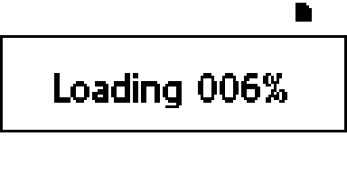 |  |
| 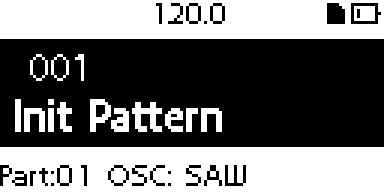 | 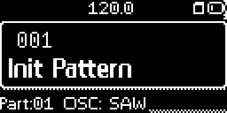 |
| 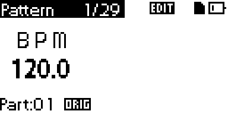 | 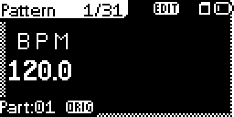 |
| 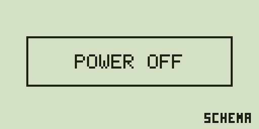 |  |

## Patch the firmware

Open **Firmware Patcher**, drop your own `SYSTEM.VSB` (Korg's original 2.02 for sampler or synth, or Hacktribe 2.02) onto the page and choose the patches. Before downloading, the emulator boots the result and checks the main screen, update prompt, start modes and emergency switch. This takes a few minutes; the page shows which group is running. It then explains how to install the file on the device. All patches and their limits are in [docs/patcher.en.md](docs/patcher.en.md). To patch without the app, use `BLECH.patch` or the matching `.bsdiff` from the release as described there.

On the sampler, BLECHTRIBE includes the BLECH menu, plugins, display and LED colours, pattern confirmation, sync groups, TAP Motion, a note assistant in KEYBOARD mode, random melodies (SHIFT + PART ERASE), EXIT + WRITE to save, EXIT + Pad to reset a part's sound, pink chord steps, migration of your existing sample folder, Blechy, loading progress, clearer sample errors and Doom (SHIFT + TAP at power-on; [licence](docs/doom-lizenz.md), German).

## For tinkerers

GELUMPE is the app behind BLECHTRIBE: an editor, emulator and firmware patcher for the Electribe 2. The blue Electribe has a separate Synth set; its tested scope and remaining limits are in the [Synth measurement](docs/messungen/2026-10-16-blech-synth.md).

## Who I am

I am Kuhler Buhler, aka Pascal, a software developer and live act. After installing Hacktribe I noticed you could edit the MFX and IFX presets. Then I spent a few months in a development frenzy, and this is what came out of it. Korg left so much of the Electribe 2's potential unused that, with BLECHTRIBE, I practically built the Electribe 3 that never happened.

If this is useful to you, a [donation via PayPal](https://www.paypal.me/kuhlerbuhler) is welcome.

## What you can do

GELUMPE runs as an app or in the browser. It reads and patches your own firmware, runs it in an emulator and lets you write plugins, edit effects and patterns, and send changes over USB MIDI. The red sampler's effect editor and RAM writes require Hacktribe or BLECHTRIBE's USB commands. An unrecognised firmware or device is read only.

**No firmware or samples ship with this.** Load your own `SYSTEM.VSB`. It stays on your computer and is not uploaded to a server.

## Preview

The app in dark mode. The emulator is shown without firmware, so its display stays black.

| | |
|---|---|
| 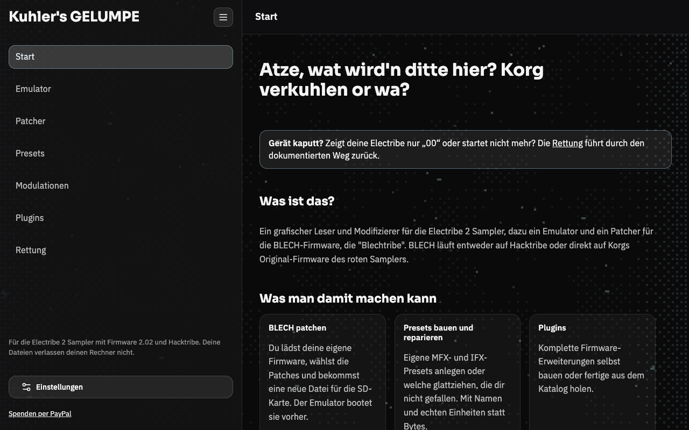 | 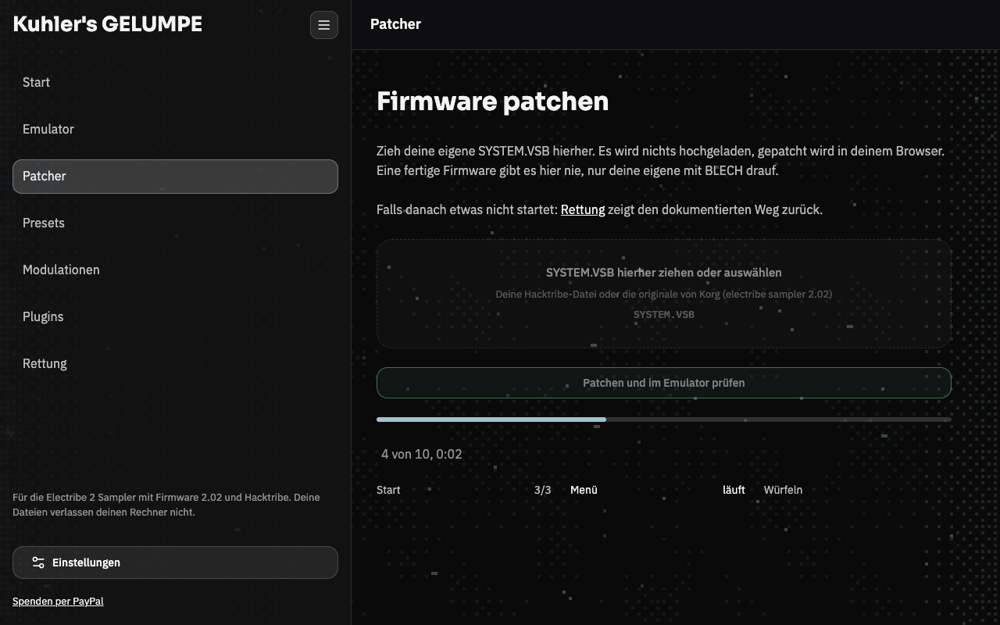 |
| Start | Patcher |
| 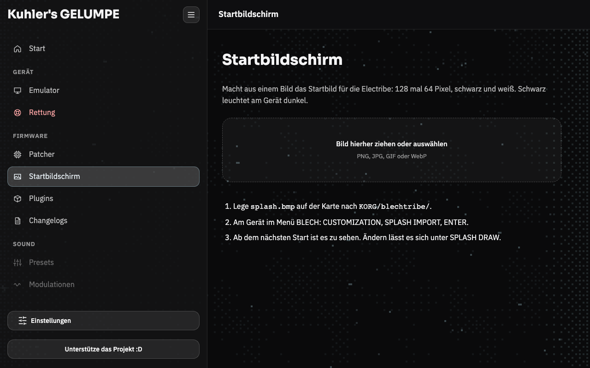 | 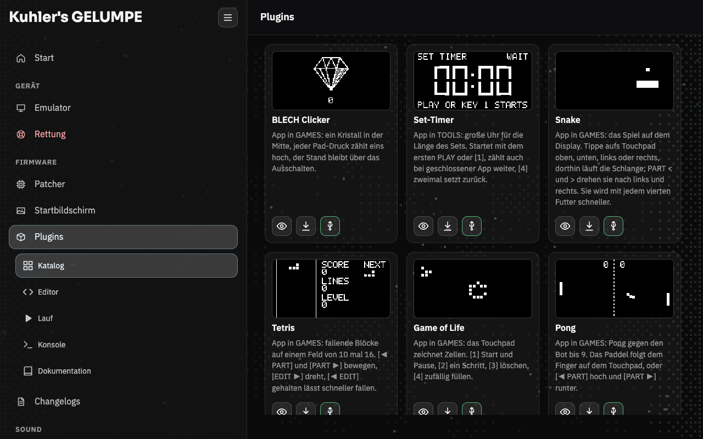 |
| Draw your own start screen | Plugin catalog |
| 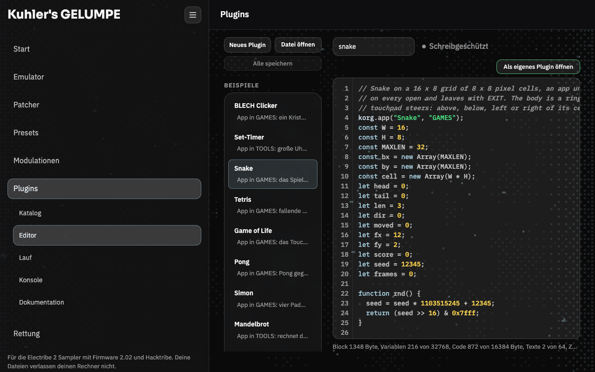 | 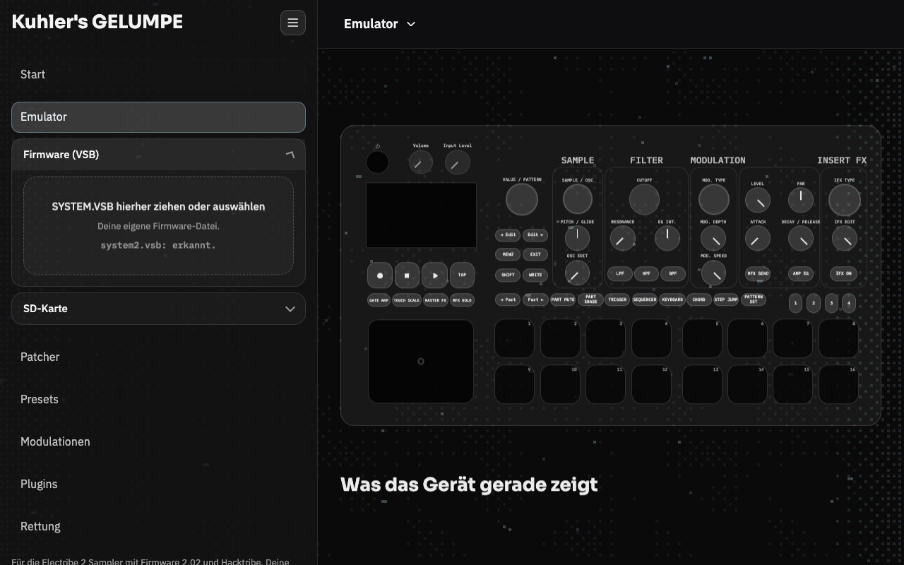 |
| Plugin editor | Emulator |

## Get the app

The Releases page of this repository has the app for macOS (Apple Silicon and Intel, one `.dmg` each), Windows
(`.exe`) and Linux (`.AppImage`, `.deb`). The app starts the emulator service itself and stops it when
you close it. The emulator's card and flash live in `~/.gelumpe`. On start and every few hours the app
checks for a newer release and shows "Neue Version verfügbar" at the top; a click downloads the file for your system into the Downloads folder and starts the installation (on failure the release page opens).

**The app is not signed.** On macOS the system blocks the downloaded app. Release it once:

```bash
xattr -dr com.apple.quarantine "/Applications/Kuhlers GELUMPE.app"
```

On Windows, SmartScreen shows a warning: "More info", then "Run anyway". The `-setup.exe` carries
WebView2 and installs it when it is missing (e.g. on Windows 10), without needing the internet.

## Quick start from source

**In the browser.** You need Node.js 20 or later, and for the emulator Python 3.10 or later.

```bash
npm ci
npm run setup:emu   # once: Python environment with Unicorn for the emulator
npm start           # page and emulator together
```

`npm start` prints the address (by default `http://127.0.0.1:8737/`), open it in your browser. Without
the emulator `npm run serve` is enough and `setup:emu` is not needed. To talk to the device you need
Chrome or Edge on a desktop computer: the page uses Web MIDI with SysEx, which Safari does not have.

The desktop app uses native MIDI ports on macOS and Linux. It needs no additional browser
or separately installed MIDI helper. On Windows the app keeps its existing Web MIDI path.

**Build the app yourself** (Tauri v2). Once: Node 20+, Python 3.10+, Rust via `rustup` and
`cargo install tauri-cli --version "^2" --locked`. Plus per system: on macOS the Xcode Command Line
Tools, on Windows the Visual Studio Build Tools with "Desktop development with C++", on Linux
`libwebkit2gtk-4.1-dev libgtk-3-dev libayatana-appindicator3-dev librsvg2-dev libssl-dev libxdo-dev
patchelf python3-venv libasound2-dev`.

```bash
npm ci
npm run app:build -- --bundles dmg            # macOS
npm run app:build -- --bundles nsis           # Windows
npm run app:build -- --bundles appimage,deb   # Linux
```

The build compiles the page, freezes the emulator service into a sidecar with PyInstaller
(`npm run build:sidecar` does just that) and packs the app. The result lands in
`src-tauri/target/release/bundle/`: `dmg/*.dmg` (macOS), `nsis/*-setup.exe` (Windows),
`appimage/*.AppImage` and `deb/*.deb` (Linux). Each system builds its own, cross-building does not
work. More (Intel Mac, Windows on ARM): [development](docs/development.md) (German).

## Plugins

A plugin gives the Electribe a new function. You put it on the device through the SD card, in the folder
`KORG/blechtribe/Plugin/`. The folder is called `Plugin`, singular, not "Plugins", and it is the same on the
red and the blue Electribe. The firmware does not create it, you do. With the device connected you can skip
the card: in the Plugins area the button "Aufs Gerät" writes the plugin there over USB, then on the device
Menü -> BLECH -> PLUGINS -> IMPORT PLUGIN. The code is a subset of JavaScript, the editor compiles it to bytecode for a
small VM in the firmware, and an error switches the plugin off without disturbing the Electribe.
Language, events and functions: [docs/plugins.en.md](docs/plugins.en.md).
The catalog has ready plugins: Set-Timer, BLECH Clicker, Snake, Tetris, Game of Life, Pong, Simon,
Mandelbrot, GIF Player, Lauflicht and Pulsieren.

## The emulator

The emulator runs the real firmware as a local service, and the page shows an operable device with a
virtual SD card. It produces no sound and does not replace listening, but you can try everything before a
device sees it. More: [docs/emulator.md](docs/emulator.md) (German). The firmware's key combinations are in
[docs/tastenkombinationen.md](docs/tastenkombinationen.md).

## Safety: before you put anything on the device

A wrong write or a faulty firmware can hang the device. So:

- **Emergency switch:** hold EXIT while powering on. The firmware then runs without patches, and DATA
  UTILITY, SOFTWARE UPDATE lets you install a different firmware. This only applies to that one start.
- **Back up before you change anything:** the SD card (samples, patterns, the original `SYSTEM.VSB`) and
  the global settings. Powering off and WRITE save whatever is in RAM, so do not power off if something
  looks wrong.
- **Way back:** put the saved original `SYSTEM.VSB` back. How that was rehearsed is in
  [docs/messungen/2026-10-10-rueckweg-geuebt.md](docs/messungen/2026-10-10-rueckweg-geuebt.md).
- **If the device no longer starts:** the "Rettung" page in the editor (German) asks what you see and
  walks you back along the documented recovery. The bootloader is never
  touched, beyond it only JTAG helps ([docs/rettung.md](docs/rettung.md)).
- **Test it yourself:** the [device tests](docs/geraetetests/README.md) describe how to repeat BLECH and
  the card functions on your own device, with a warning, prerequisites, a backup and the way back.

The linter checks known memory regions, message format and documented failure cases. The emulator runs
the firmware's real ARM code, but the DSP only as a stand-in: it makes no sound, and it only imitates the
panel and the timing. Whether something sounds good, only your ears can say. Much is so far checked in
the emulator only, not yet on a real device. Details: [docs/linter.md](docs/linter.md),
[docs/emulator.md](docs/emulator.md) (German).

## Documentation

[docs/README.md](docs/README.md) is the index: plugins, patcher, emulator, the device map, the
measurements on the device, ideas and background. For working on the code:
[docs/development.md](docs/development.md). The docs are in German, except the pages on
[plugins](docs/plugins.en.md) and the [patcher](docs/patcher.en.md), which also exist in English.

AI agents also work on this project. The rules for them are in [AGENTS.md](AGENTS.md).

## Contributing

Pull requests go to `develop`, not to `main`. The rules are in [CONTRIBUTING.md](CONTRIBUTING.md); the most important
one: no Korg data in the repository, ever. A check closes a pull request that carries any. If you find something that
can damage a device, report it privately ([SECURITY.md](SECURITY.md)).

## Licence

AGPL-3.0, see [`LICENSE`](LICENSE). Where the parts come from is in [`NOTICE`](NOTICE).
