[English version](README.en.md)

<picture>
  <source media="(prefers-color-scheme: dark)" srcset="assets/readme/banner-dark.svg">
  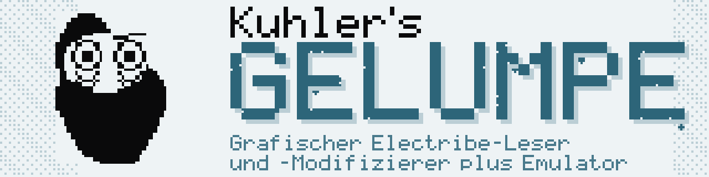
</picture>

<h3 align="center">BLECHTRIBE: neue Firmware für deine Electribe 2. Kostenlos.</h3>

<p align="center">BLECHTRIBE ist ein eigenes Firmware-Upgrade für die Electribe 2. Es läuft direkt auf Korgs Original-Firmware 2.02 und ist keine Hacktribe-Variante. Du brauchst kein Hacktribe. Hacktribe ist ein anderes Projekt, du kannst es zusätzlich nutzen, musst es aber nicht.</p>

<p align="center">
  <a href="https://github.com/KuhlerBuhler/kuhlers-gelumpe/releases/latest"></a>
</p>

<p align="center">Du musst hier nichts suchen und keinen Code anfassen. Klick auf den Knopf, lade die App für deinen Rechner, fertig.</p>

## Inhalt

- [Häufige Fragen](#häufige-fragen)
- [So kommt BLECHTRIBE auf deine Electribe](#so-kommt-blechtribe-auf-deine-electribe)
- [Was kann was?](#was-kann-was)
- [Was BLECHTRIBE kann](#was-blechtribe-kann)
- [Vorher und nachher](#vorher-und-nachher)
- [Die Firmware patchen](#die-firmware-patchen)
- [Die App laden](#die-app-laden)
- [Plugins](#plugins)
- [Der Emulator](#der-emulator)
- [Sicherheit](#sicherheit-bevor-du-etwas-aufs-gerät-spielst)
- [Mitmachen](#mitmachen)

## Häufige Fragen

- **Kostet das was?** Nein. Wenn du magst, freu ich mich über eine [Spende](https://www.paypal.me/kuhlerbuhler).
- **Ist das sicher?** Die App prüft die neue Firmware zuerst im Emulator. Das fängt viele Fehler ab, garantiert aber nicht das Verhalten jedes echten Geräts. Sichere vorher deine Original-Firmware und deine Daten.
  Der [Notschalter](docs/glossary.md#notschalter): **EXIT beim Einschalten halten**, dann startet die Electribe ohne BLECHTRIBE, und du spielst dein Original wieder auf.
- **Brauch ich einen PC?** Ja, einmal zum Umbauen der Datei. Danach nicht mehr.
- **Sind Samples dabei?** Nein. BLECHTRIBE bringt keine Samples mit, deine eigenen Samples bleiben erhalten. Beim ersten Start bietet die Electribe an, deinen Sample-Ordner zu übernehmen.
- **Geht das mit der blauen Electribe?** Ja, mit etwas weniger Funktionen, siehe Tabelle.
- **Blaue Electribe: wo sind meine Exporte?** In `KORG/blechtribe/`, nicht mehr in `KORG/electribe/`. Beim ersten Start bietet die Electribe an, `KORG/electribe/` dorthin zu kopieren.
- **Brauche ich [Hacktribe](docs/glossary.md#hacktribe)?** Nein. BLECHTRIBE läuft direkt auf Korgs Original. Wenn du schon Hacktribe hast, kannst du BLECHTRIBE darauf installieren, dann bleiben Hacktribes eigene Funktionen erhalten. Auf Korgs Original schaltet BLECHTRIBE die Hacktribe-Funktionen nicht frei.
- **Wie kann ich eigene Effekte machen?** In der App im [**Baukasten**](docs/glossary.md#baukasten). Da nimmst du einen fertigen Effekt oder baust einen aus Bausteinen, mit Namen und echten Einheiten. Über den Export kommen sie auf die SD-Karte (rot und blau), einzelne auch live per USB (nur rot). Beides mit BLECHTRIBE. Auf der blauen ist das bisher nur im Emulator geprüft.
- **Windows: Die App findet meine Electribe nicht, obwohl die MIDI-Ports da sind.** Dann ist wohl Korgs eigener USB-MIDI-Treiber drauf, über den kommen die Antworten der Electribe nicht an. Nimm ihn im Geräte-Manager raus (die Electribe, "Gerät deinstallieren", mit Treiber) und starte Windows neu, Windows' eigener Treiber reicht. Will das KORG Driver Setup Utility ihn danach wieder installieren, mach es einfach zu. Der MIDI-Bericht in den Einstellungen sagt das auch.
- **Ich hab eine Idee für die App oder die Firmware.** Immer her damit: [Idee aufschreiben](https://github.com/KuhlerBuhler/kuhlers-gelumpe/issues/new?template=idea.yml). Dafür brauchst du ein GitHub-Konto.

## So kommt BLECHTRIBE auf deine Electribe

Du brauchst einen Rechner (Mac, Windows oder Linux) und einen SD-Kartenleser. Einmal, für ein paar Minuten.

1. **App laden** über den Knopf oben. Auf der Seite ganz unten bei "Assets": `.dmg` für Mac, `.exe` für Windows, `.AppImage` oder `.deb` für Linux.
   Auf dem Mac blockiert das System die App beim ersten Öffnen, weil sie nicht von Apple signiert ist. Wie du sie freigibst, steht unter [Die App laden](#die-app-laden).
2. **SD-Karte** aus der Electribe in den Rechner stecken.
3. **App öffnen**, links auf **Firmware Patcher**, dann die Datei [`SYSTEM.VSB`](docs/glossary.md#vsb) von deiner Karte reinziehen.
   Du findest sie im Ordner `KORG/electribe sampler/System/` (rotes Original) oder `KORG/electribe/System/` (blaue Electribe). Nur wenn du Hacktribe benutzt, liegt sie in `KORG/hacktribe/System/`.
   Hast du die Datei nicht, lädt die App Korgs Original selbst, wenn du Korgs Lizenz annimmst.
4. **Warten**, bis die App fertig geprüft hat (ein paar Minuten), dann die neue Datei speichern.
   Die App sagt dir, wohin sie auf der Karte muss.
5. **Karte zurück in die Electribe**, einschalten und am Gerät das Update starten. Die App zeigt dir die Tasten dazu.

Klappt etwas nicht? Die App sagt dir, was los ist. Wenn du trotzdem nicht weiterkommst, schreib mir, mit einem Foto der Meldung.

## Was kann was?

| | Sampler (rot) Original | Synth (blau) Original | Sampler mit Hacktribe | **BLECHTRIBE** rot | **BLECHTRIBE** blau | **BLECHTRIBE** mit Hacktribe |
|---|:-:|:-:|:-:|:-:|:-:|:-:|
| Eigene Samples aufnehmen | ✅ | ➖ | ✅ | ✅ | ➖ | ✅ |
| Eigene Samples laden (blau: aus der Sample-Datei als Gruppe `[User]`, bis 64) | ✅ | ➖ | ✅ | ✅ | ✅ | ✅ |
| Oszillatoren wie bei Hacktribe (Dual, Oct, Chip, ...), bei BLECHTRIBE als Nachbau | ❌ | ❌ | ✅ | ✅ | ❌ | ✅ |
| Inserts wie bei Hacktribe (Lag, KP2 Comp, Drive-Filter, Delays), bei BLECHTRIBE als Nachbau | ❌ | ❌ | ✅ | ✅ | ❌ | ✅ |
| Master-Effekte wie bei Hacktribe (Big Hall, Plate Reverb, Tap Delay Sync, Tube Drive), bei BLECHTRIBE als Nachbau | ❌ | ❌ | ✅ | ✅ | ❌ | ✅ |
| Zusätzliche Hacktribe-Grooves und Skalen | ❌ | ❌ | ✅ | ❌ | ❌ | ✅ |
| FX und Grooves über die Hacktribe-Menüs importieren/exportieren | ❌ | ❌ | ✅ | ❌ | ❌ | ✅ |
| Eigenes INIT-Pattern | ❌ | ❌ | ✅ | ✅ | ✅ | ✅ |
| Hacktribe-SysEx (für den Hacktribe-Editor) | ❌ | ❌ | ✅ | ❌ | ❌ | ✅ |
| Eigene USB-Befehle für die App (Karte, Plugins, RAM; auf der blauen RAM nur lesen) | ❌ | ❌ | ❌ | ✅ | ✅ | ✅ |
| Unveränderte Werks-Samplebank der roten Electribe nutzen | ✅ | ➖ | ❌ | ✅ | ➖ | ❌ |
| Anpassbare Oberfläche (Startbild, Schrift, Ausschaltbild) | ❌ | ❌ | ❌ | ✅ | ✅ | ✅ |
| Ladeanimation mit Fortschritt | ❌ | ➖ | ❌ | ✅ | ➖ | ✅ |
| Startbild selbst malen | ❌ | ❌ | ❌ | ✅ | ✅ | ✅ |
| Synth-Filter (MS20, Acid, ...) | ❌ | ✅ | ✅ | ✅ | ✅ | ✅ |
| Effekte frei bearbeiten (App) | ❌ | ❌ | ✅ | ✅ | ❌ | ✅ |
| 128 Plätze für eigene Effekte | ❌ | ❌ | ❌ | ✅ | ✅ | ✅ |
| Zweiter Master-Effekt (MFX 2) | ❌ | ❌ | ❌ | ✅ | ✅ | ✅ |
| BEAT 8: Steps als Achtel, Pattern doppelt so lang | ❌ | ❌ | ❌ | ✅ | ✅ | ✅ |
| TOUCH SCALE RANGE 0: X spielt fest den Grundton | ❌ | ❌ | ❌ | ✅ | ✅ | ✅ |
| Samples auf Werks-Slots importieren | ❌ | ➖ | ❌ | ✅ | ➖ | ✅ |
| Plugins und Spiele (Snake, Tetris, ...) | ❌ | ❌ | ❌ | ✅ | ✅ | ✅ |
| Pad-Farben und LED-Farben | ❌ | ❌ | ❌ | ✅ | ✅ | ✅ |
| Patternwechsel erst nach Bestätigung | ❌ | ❌ | ❌ | ✅ | ✅ | ✅ |
| Sync-Gruppen (Patterns spielen wie eins) | ❌ | ❌ | ❌ | ✅ | ✅ | ✅ |
| Schnell speichern (EXIT + WRITE), Part zurücksetzen (EXIT + Pad) | ❌ | ❌ | ❌ | ✅ | ✅ | ✅ |
| Jeden Klang beenden (STOP halten) | ❌ | ❌ | ❌ | ✅ | ✅ | ✅ |
| KEY über die Pads (KEYBOARD + Pad) | ❌ | ❌ | ❌ | ✅ | ✅ | ✅ |
| Filter an und aus (SHIFT + Filtertaste) | ❌ | ❌ | ❌ | ✅ | ✅ | ✅ |
| Einstellungen speichern sich beim Verlassen des Menüs (AUTO SAVE) | ❌ | ❌ | ❌ | ✅ | ✅ | ✅ |
| Akkord-Pads farbig hervorheben | ❌ | ❌ | ❌ | ✅ | ✅ | ✅ |
| Motion Sequences ein- und ausschalten | ❌ | ❌ | ❌ | ✅ | ✅ | ✅ |
| Notenassistent | ❌ | ❌ | ❌ | ✅ | ✅ | ✅ |
| Würfeln (Zufallsmelodie) | ❌ | ❌ | ❌ | ✅ | ✅ | ✅ |
| Klare Meldung bei kaputten Samples | ❌ | ➖ | ❌ | ✅ | ✅ | ✅ |
| Röhrenkurve am Ausgang (TUBE) | ❌ | ❌ | ❌ | ✅ | ✅ | ✅ |
| Gerätemenüs auf Deutsch (nur mit Häkchen im Patcher der App, nicht in den fertigen Dateien im Release) | ❌ | ❌ | ❌ | ✅ | ✅ | ✅ |
| Doom | ❌ | ❌ | ❌ | ✅ | ❌ | ✅ |
| Update über USB aus der App | ❌ | ❌ | ❌ | ✅ | ✅ | ✅ |

➖ heißt: gibt es auf dem Synth nicht, weil er nichts aufnimmt und keine Werks-Samples hat.

Hacktribe ist ein eigenes, fremdes Projekt. BLECHTRIBE braucht es nicht, kann aber auch auf einer Hacktribe-Datei installiert werden. Auf Korgs Original
schaltet BLECHTRIBE die Hacktribe-Funktionen nicht frei. Ausnahme sind drei Nachbauten, die auf der roten BLECHTRIBE ohne Hacktribe laufen: die Hacktribe-ähnlichen Oszillatoren
auf den freien Anzeige-Plätzen 422 bis 497, immer an, ohne Schalter, die 11 Inserts
auf den IFX-Plätzen 39 bis 49 und die 4 Master-Effekte auf den MFX-Plätzen 33 bis 36. Die Spalten "BLECHTRIBE rot" und "BLECHTRIBE mit Hacktribe" sind dasselbe Produkt, nur die Basisdatei ist eine andere. Die blaue BLECHTRIBE-Spalte
meint den Synth-Satz auf Korg 2.02. Hacktribe selbst unterstützt laut Projekt beide Hardwaretypen.

**Was du bei Hacktribe abwägen musst:**

| Nachteil | Was das für dich heißt |
|---|---|
| Die Werks-Samplebank wird durch Oszillatoren ersetzt | Die eigenen Samples liegen auf 501 bis 999. Werks-Samples müssen für Hacktribe umgewandelt und in die eigene Bank geladen werden. Erst BLECHTRIBE 1.5 lässt mit Hacktribe auch einen Import ab Slot 275 zu. |
| Deine Samples sind danach nicht mehr da | Hacktribe liest einen eigenen Ordner, und seine Anleitung sagt, `e2sSample.all` zu löschen. Sichere vorher den `Sample`-Ordner deiner jetzigen Firmware (`KORG/electribe sampler/` oder `KORG/blechtribe/`), die App fragt das mit einem Häkchen ab. Schon passiert? Die Seite Blechy hat den Fall "Ich hab aus Versehen Hacktribe installiert". |
| Alte Patterns können anders klingen | Oszillator- und Effektzuordnungen ändern sich. Nach dem Umstieg die eigenen Patterns durchhören und bei Bedarf neu zuordnen. |
| Zusätzlicher Firmwarewechsel | Wer Korgs Original nutzt, braucht zuerst eine passende Hacktribe-Datei. BLECHTRIBE läuft auch direkt auf dem Original, das ist der Normalfall. |

Funktionen und Umstieg: [Hacktribe](https://github.com/bangcorrupt/hacktribe),
[Oszillatorbank](https://github.com/bangcorrupt/hacktribe/wiki/Features#oscillators),
[Werks-Samples](https://github.com/bangcorrupt/hacktribe/wiki/How-To#factory-samples) und
[FAQ](https://github.com/bangcorrupt/hacktribe/wiki/FAQ).

## Was BLECHTRIBE kann

Das Wichtigste in einem Satz je Sache. Welche Electribe was kann, zeigt die Tabelle oben. "Nur im Emulator geprüft" heißt: am echten Gerät noch nicht.

**Samples**

- **Sample Swap (neu in 1.5, rot):** Sehr große Sample-Sammlungen (über 25 MB) passen auf die rote Electribe, weil nur die Samples im Speicher liegen, die das spielende Pattern braucht, der Rest bleibt auf der Karte und wird beim Patternwechsel nachgeladen. Im Emulator geprüft, am Gerät erst teilweise.
- **Sample-Kategorie (neu in 1.5, rot):** In DATA UTILITY > SAMPLE EDIT stellst du für jedes Sample eine von 18 Kategorien ein (Kick, Snare ...), so findest du es mit SHIFT + OSC-Rad wieder. Die Kategorie landet mit EXPORT ALL SAMPLE auf der Karte. Nur im Emulator geprüft.
- **Samples auf Werks-Plätzen (neu in 1.5, rot):** IMPORT SAMPLE kann jetzt auch ein Werks-Sample ersetzen: als Ziel geht jede Nummer ab 19 (mit Hacktribe ab 275), nicht mehr nur 501 bis 999.
- **Eigene Samples auf der blauen (neu in 1.5):** Die blaue Electribe lädt deine Samples beim Einschalten aus der Sample-Datei auf der Karte, sie erscheinen als Oszillatorgruppe `[User]`. Bis zu 64 Samples, zusammen etwa eine Minute. Du legst sie in der App auf der Seite Samples auf die Karte (Schalter auf blau) oder holst eine WAV direkt am Gerät mit DATA UTILITY > IMPORT SAMPLE, sie spielt dann sofort. DATA UTILITY > SAMPLE EDIT stellt Start, Loop, Ende, Tune, Pegel und neu REVERSE ein. Nur im Emulator geprüft.
- **Stereo-Samples:** Ein Stereo-Sample belegt nur noch ein Pad, das Pad daneben spielt wieder sein eigenes Sample (rot, abschaltbar unter BLECH > FEATURES > STEREO 1 PAD).
- **Samples in der App:** Auf der Seite Samples siehst du die Samples deiner Electribe, fügst WAV-Dateien hinzu und entfernst Samples, per Kartenleser oder direkt über das USB-Kabel.

**Patterns**

- **Sync-Gruppen:** Mehrere Patterns mit derselben Gruppennummer spielen als eins, für mehr als 128 Steps. Lange Samples klingen beim Wechsel weiter, und Live-Änderungen wie Tonhöhe oder Modulation gehen ins nächste Pattern mit.
- **Pattern ansehen, während eins läuft:** Drehst du beim Spielen am Rad, siehst du das nächste Pattern samt Tempo. Du kannst es anspielen und einzelne Parts ins laufende Pattern holen, bevor du mit MENU wechselst.
- **Patterns-Ordner (neu in 1.5, rot):** Patterns exportierst und importierst du im Ordner `KORG/blechtribe/Patterns/`. Liegt dort die Sicherung `electribe_sampler_allpattern.e2sallpat`, lädt die Electribe sie bei jedem Start. Speicherst du am Gerät, exportiere danach wieder, sonst gilt beim nächsten Start der Stand der Datei. Nur im Emulator geprüft.
- **MFX 2:** Jeder der beiden Master-Effekte merkt sich sein eigenes MFX HOLD und seine Pad-Position (neu in 1.5, rot).

**Effekte**

- **Fertige Effekte:** Im Baukasten liegen fertige Effekte, zum Beispiel Bounce Gate, Hardtekk Kick, Warm Drive, Bit Grinder, Glue Comp und ULTRA LOUD, dazu Modulationen wie Kick Drop. Die Liste steht in [docs/effekt-katalog.md](docs/effekt-katalog.md).
- **Eigene Effekte auf der blauen (neu in 1.5):** Auch die blaue Electribe bekommt den Effekt-Katalog, 128 Plätze für eigene Effekte und den Export auf die Karte. Live per USB bearbeiten geht dort noch nicht. Nur im Emulator geprüft.

**Anzeige und Strom**

- **IDLE SAVE (neu in 1.5):** Dimmt Display und LEDs, wenn keiner spielt (Standard: nur auf Batterie).
- **BATTERY % (neu in 1.5):** Zeigt den Ladestand als Zahl, wenn du mit Batterie spielst und in den Global-Einstellungen BATTERY TYPE auf Alkali steht.
- **LOAD METER:** Zeigt die Prozessorlast oben im Display (standardmäßig aus).
- **KNOB LEDS:** Schaltet die Lichter hinter den Reglern aus.
- **Startbild und Ladeanimation (neu in 1.5, rot):** Du legst sie als Datei in `KORG/blechtribe/Media/` auf die Karte, ohne die Firmware neu zu bauen. Die App Image Viewer zeigt alle Bilder dort.

**App und Plugins**

- **App:** Die App gibt es in 11 Sprachen. Sie verbindet sich selbst mit der Electribe, speichert die fertige Firmware auf Wunsch direkt auf die SD-Karte, und die Seite Blechy beantwortet Fragen zur Bedienung und führt dich zurück, wenn das Gerät nicht startet.
- **Plugins:** Plugins können Steps schreiben, MIDI senden, den Ausgangspegel lesen, Pads und Tasten abfangen, Timer nutzen und je 16 Dateien auf der Karte speichern.

## Vorher und nachher

Links die normale Electribe, rechts mit BLECHTRIBE. Die Animationen verwenden die eigenen
Firmwaregrafiken; der Ladeabschluss bleibt hier länger sichtbar. Das normale Ausschalten ist
schematisch mit unserer eigenen Schrift dargestellt.

| Normal | BLECHTRIBE |
|:-:|:-:|
| 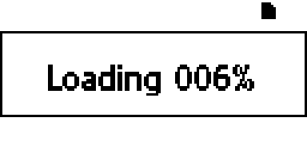 |  |
| 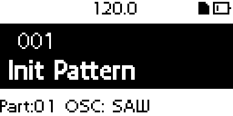 | 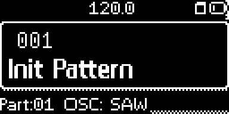 |
| 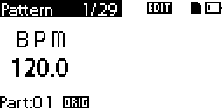 | 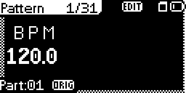 |
| 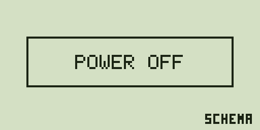 |  |

---

## Die Firmware patchen

Auf der Seite "Firmware Patcher" ziehst du deine eigene `SYSTEM.VSB` rein (Korgs Original 2.02 für Sampler oder
Synth, oder Hacktribe 2.02; ohne eigene Datei lädt die App Korgs Original nach deiner Zustimmung zu Korgs Lizenz), wählst die Patches aus und bekommst eine neue Datei. Bevor du die
runterladen kannst, bootet der Emulator sie und prüft, ob alles läuft: Hauptbildschirm, Update-Abfrage,
Startmodi, Notschalter. Das dauert ein paar Minuten, du siehst dabei, welche Gruppe gerade dran ist.
Danach zeigt dir die Seite, wie du die Datei aufs Gerät bekommst. Alle Patches und ihre Grenzen stehen in
[docs/patcher.md](docs/patcher.md). Wer ohne App patchen will, nimmt `BLECH.patch` oder die passende
`.bsdiff`-Datei aus dem Release, das steht da auch.

Was BLECHTRIBE auf dem Sampler so mitbringt: ein eigenes Menü BLECH mit Plugins, Farben für Display und
LEDs, Patternwechsel erst nach Bestätigung, Sync-Gruppen, TAP Motion, den Notenassistenten im KEYBOARD-Modus, KEYBOARD + Pad setzt den KEY, SHIFT + Filtertaste schaltet das Filter aus und an, einen
Melodie-Generator (SHIFT + PART ERASE), EXIT + WRITE zum Speichern (die WRITE-LED atmet, solange etwas ungespeichert ist), EXIT + Pad setzt den Klang eines Parts
zurück (auch beim Abspielen), STOP halten beendet jeden Klang, Akkord-Steps von Poly-Parts in Pink, beim ersten Start die Übernahme deines
hacktribe- oder electribe-sampler-Ordners, [Blechy](docs/glossary.md#blechy) als kleines Haustier, ein Startbild mit Ladebalken,
verständliche Meldungen statt "Unknown Error" beim Sample-Laden, eine Röhrenkurve am Ausgang (BLECH > FEATURES > TUBE), Menüs auf Deutsch (Häkchen im Patcher der App) und Doom (SHIFT + TAP beim Einschalten, die zwei Dateien schreibt die App per USB auf die Karte,
zur Lizenz siehe [docs/doom-lizenz.md](docs/doom-lizenz.md)).

## Für Bastler

GELUMPE ist das Programm dahinter: deine Electribe 2 auslesen und umbauen, mit einem Emulator (eine Electribe im Rechner) und dem Patcher für BLECHTRIBE. Was auf der blauen Electribe genau geht, steht in der
[Synth-Messung](docs/messungen/2026-10-16-blech-synth.md).

## Wer ich bin

Ich bin Kuhler Buhler, aka Pascal, arbeite als Softwareentwickler und bin ein Live Act. Als ich Hacktribe installiert hab,
ist mir aufgefallen, dass man die MFX- und IFX-Presets ja selbst bearbeiten kann. Tja, und dann war ich
ein paar Monate in einer Entwicklungspsychose, und das hier ist dabei rausgekommen. BLECHTRIBE ist dabei ein eigener Patch auf Korgs Original geworden, kein Hacktribe-Ableger.

Warum das Ganze? Mich nervt, was Korg aus der Electribe 2 gemacht hat, nämlich nix. Da ist so viel mehr
drin, als Korg jemals rausgeholt hat. Mit BLECHTRIBE hab ich mir praktisch die Electribe 3 gebaut, die es
nie gab.

Wenn dir das was bringt, freu ich mich über eine [Spende per PayPal](https://www.paypal.me/kuhlerbuhler).

## Was du damit machen kannst

GELUMPE läuft als App oder im Browser und funktioniert mit der Electribe 2 mit Firmware 2.02, dem
roten Sampler (Korgs Original, optional auch [Hacktribe](https://github.com/bangcorrupt/hacktribe)) und der
blauen Synth (Korgs Original). Du brauchst Hacktribe nicht. Du kannst

- die Firmware deiner Electribe im **Emulator** starten und bedienen, mit Display, Tasten, Reglern
  und LEDs, ohne dass irgendwas an dein Gerät geht,
- deine `SYSTEM.VSB` **patchen** und daraus eine neue Firmware-Datei für die SD-Karte machen
  (BLECHTRIBE, eigenes Startbild, zweiter Master-Effekt und einiges mehr),
- **Plugins** schreiben, die direkt auf der Electribe laufen, zum Beispiel ein Lauflicht, ein Spiel
  auf dem Display oder eine eigene Menüseite, oder fertige aus dem Katalog nehmen. Sie liegen auf der
  Karte im Ordner `KORG/blechtribe/Plugin/` (Einzahl, nicht "Plugins"), bei der roten wie bei der blauen
  Electribe. Mit verbundenem Gerät schickt sie der Knopf "Aufs Gerät" per USB dorthin,
- im **Baukasten** eigene Effekte und Modulationen bauen, mit echten Einheiten statt Bytes, und sie
  als `.e2fx`-Datei weitergeben oder als eine Datei für die Karte exportieren. Eine `.e2fx` öffnest du
  unter BLECHTRIBE -> Baukasten -> Meine Effekte -> ".e2fx-Datei öffnen", mit geladener Firmware auch unter
  BLECHTRIBE -> Presets -> "Preset-Datei laden",
- Patterns bearbeiten und per Web MIDI ans Gerät schicken.

Bevor irgendwas ans Gerät geht, schauen ein [Linter](docs/glossary.md#linter) mit Regeln, die ich am echten Gerät abgeglichen hab,
und der Emulator drüber, ob die Electribe das voraussichtlich schluckt. Emulator, Patcher und Plugins
laufen mit Korgs Original 2.02 und mit Hacktribe 2.02. Der Effekt-Editor und das Schreiben ins RAM über MIDI brauchen auf dem roten Sampler
BLECHTRIBE mit seinen eigenen USB-Befehlen (oder Hacktribe). Bei anderen Firmware-Ständen liegen die Adressen woanders, deshalb wird
ein unbekanntes Gerät oder eine unbekannte Datei nur gelesen und nie beschrieben.

**Firmware ist nicht dabei.** Du lädst deine eigene `SYSTEM.VSB`, und die bleibt auf deinem Rechner.
Nichts davon landet auf irgendeinem Server.

## Vorschau

Die App im Dunkelmodus. Der Emulator ist hier ohne Firmware zu sehen, das Display bleibt schwarz.

| | |
|---|---|
| 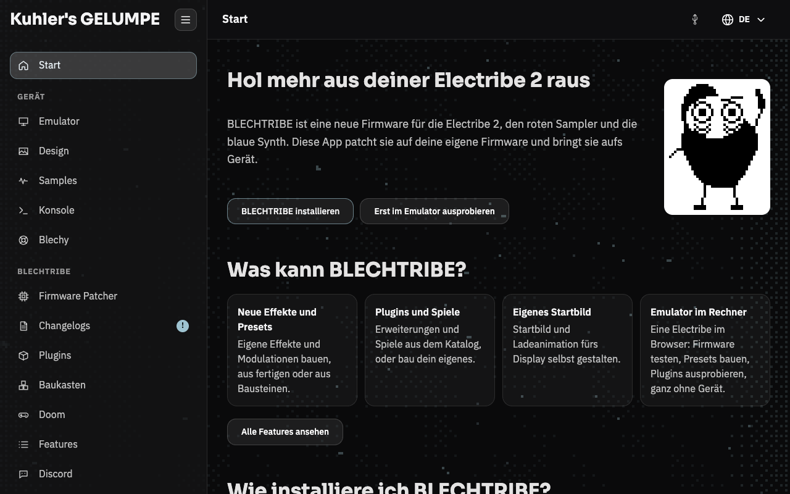 | 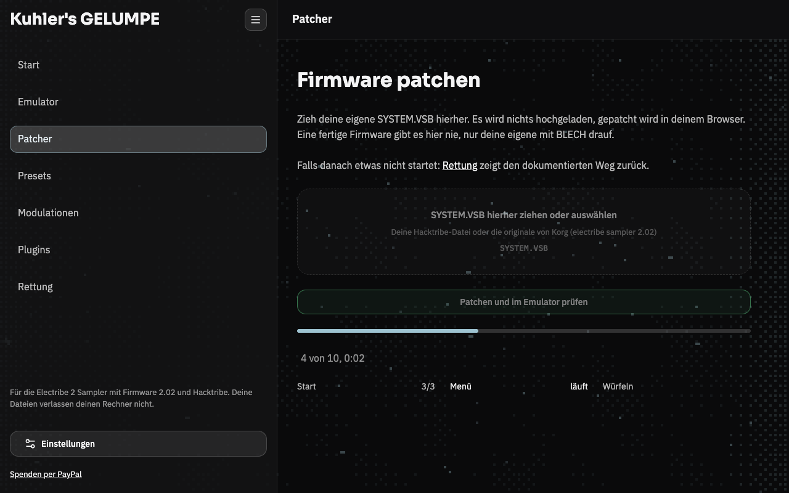 |
| Start | Patcher |
| 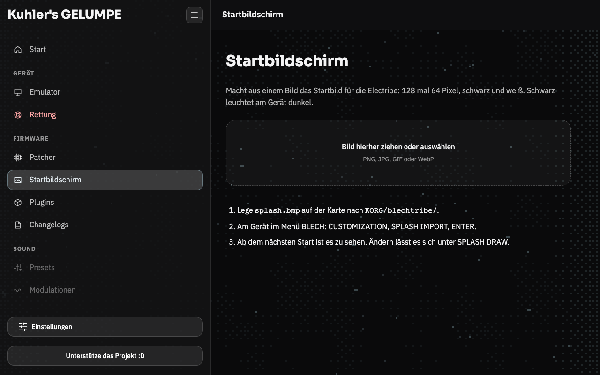 | 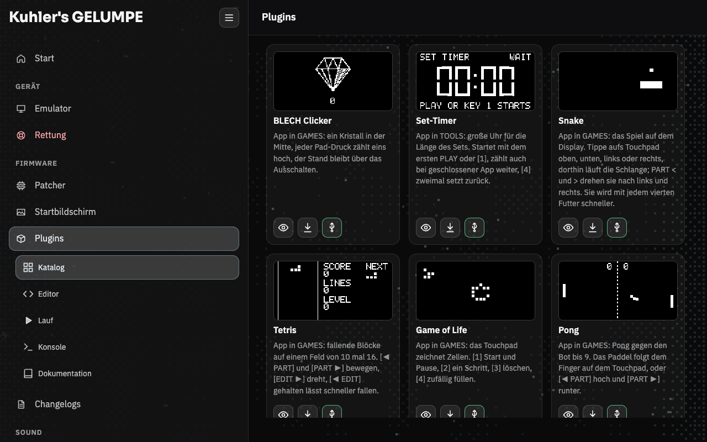 |
| Startbildschirm selbst malen | Plugin-Katalog |
| 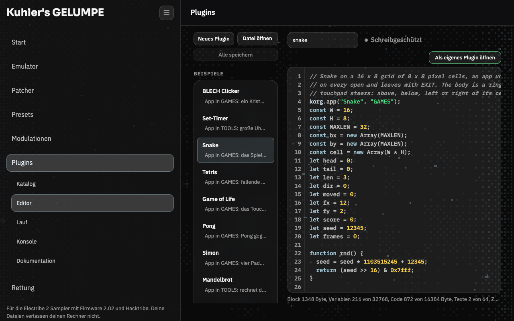 | 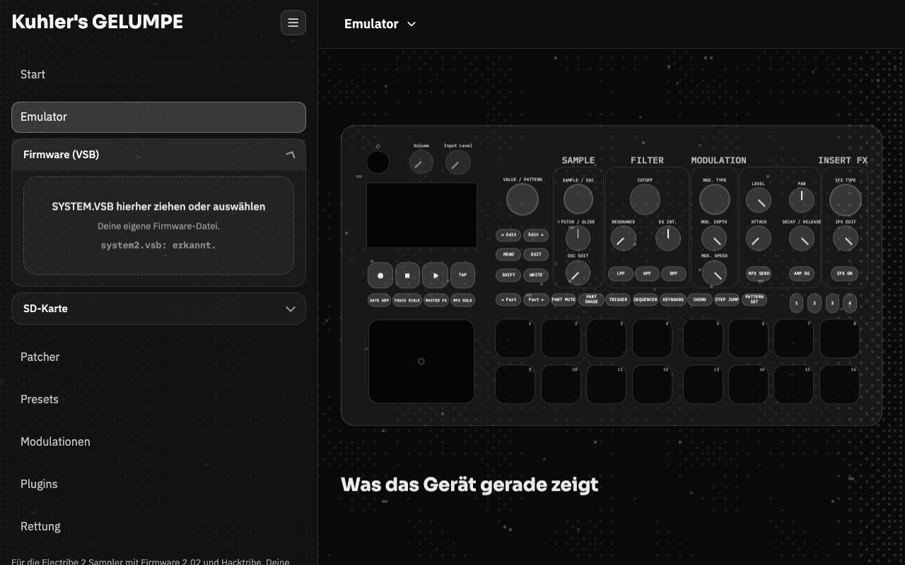 |
| Plugin-Editor | Emulator |

## Die App laden

Auf der Releases-Seite dieses Repositories liegt die App für macOS (Apple Silicon und Intel, je eine `.dmg`), Windows (`.exe`) und Linux (`.AppImage`, `.deb`). Die App startet den
Emulator-Dienst selbst und beendet ihn beim Schließen. Karte und Flash des Emulators liegen
in `~/.gelumpe`. Beim Start und alle paar Stunden prüft die App, ob es ein neueres Release
gibt, und zeigt dann oben "Neue Version verfügbar". Ein Klick lädt die passende Datei in den Downloads-Ordner und startet die Installation (klappt das nicht, öffnet sich die Release-Seite).

**Die App ist nicht signiert.** Unter macOS blockiert das System die geladene App. Einmal
freigeben:

```bash
xattr -dr com.apple.quarantine "/Applications/Kuhlers GELUMPE.app"
```

Unter Windows zeigt SmartScreen eine Warnung: "Weitere Informationen", dann "Trotzdem
ausführen". Die `-setup.exe` bringt WebView2 mit und installiert es, wenn es fehlt (etwa unter
Windows 10), auch ohne Internet.

## Schnellstart aus den Quellen

**Im Browser.** Du brauchst Node.js 20 oder neuer, für den Emulator Python 3.10 oder neuer.

```bash
npm ci
npm run setup:emu   # einmalig: Python-Umgebung mit Unicorn für den Emulator
npm start           # Seite und Emulator zusammen
```

`npm start` zeigt die Adresse an (standardmäßig `http://127.0.0.1:8737/`), die öffnest du im Browser.
Ohne Emulator reicht `npm run serve`, dann entfällt `setup:emu`. Für die Kommunikation mit dem Gerät
brauchst du Chrome oder Edge auf einem Desktopcomputer, die Seite nutzt Web MIDI mit [SysEx](docs/glossary.md#sysex), das Safari
nicht kann.

**Im Container.** Ohne Node und Python auf dem Rechner läuft dasselbe Paar in Docker:

```bash
mkdir SD
docker compose up --build
```

Danach http://localhost:8737/ öffnen. Die Karte des Emulators liegt im Ordner `SD`, ein neuer Container
behält sie. Wie du das Abbild nimmst, das ein Release veröffentlicht hat, statt selbst zu bauen, steht in
[Entwicklung](docs/development.md#im-container).

Die Desktop-App spricht auf macOS und Linux nativ mit den MIDI-Ports. Dafür braucht sie
keinen zusätzlichen Browser und keinen separat installierten MIDI-Helfer. Unter Windows
bleibt die App vorerst bei Web MIDI.

**Die App selbst bauen** (Tauri v2). Einmalig: Node 20+, Python 3.10+, Rust über `rustup` und
`cargo install tauri-cli --version "^2" --locked`. Dazu je nach System: unter macOS die Xcode Command
Line Tools, unter Windows die Visual Studio Build Tools mit "Desktop development with C++", unter Linux
`libwebkit2gtk-4.1-dev libgtk-3-dev libayatana-appindicator3-dev librsvg2-dev libssl-dev libxdo-dev
patchelf python3-venv libasound2-dev`.

```bash
npm ci
npm run app:build -- --bundles dmg            # macOS
npm run app:build -- --bundles nsis           # Windows
npm run app:build -- --bundles appimage,deb   # Linux
```

Der Build baut die Seite, friert den Emulator-Dienst per PyInstaller zu einem [Sidecar](docs/glossary.md#sidecar) ein
(`npm run build:sidecar` macht nur das) und packt die App. Das Ergebnis liegt unter
`src-tauri/target/release/bundle/`: `dmg/*.dmg` (macOS), `nsis/*-setup.exe` (Windows),
`appimage/*.AppImage` und `deb/*.deb` (Linux). Gebaut wird auf dem jeweiligen System, quer geht
nicht. Mehr dazu (Intel-Mac, Windows auf ARM): [Entwicklung](docs/development.md).

## Plugins

Mit einem Plugin bringst du der Electribe was Neues bei. Es kommt über die SD-Karte in den Ordner
`KORG/blechtribe/Plugin/`. Der Ordner heißt `Plugin`, Einzahl, nicht "Plugins", und er ist bei der roten
und der blauen Electribe derselbe. Die Firmware legt ihn nicht selbst an, du erstellst ihn. Ist das Gerät
verbunden, geht es auch ohne Karte: im Bereich Plugins schreibt der Knopf "Aufs Gerät" das Plugin per USB
dorthin, danach am Gerät Menü -> BLECH -> PLUGINS. Steckt nur die Karte im Rechner, heißt der Knopf „Auf die Karte“ und schreibt das
Plugin direkt auf die Karte. Geschrieben wird in einer abgespeckten Form von JavaScript, der Editor
übersetzt das in Bytecode für eine kleine VM in der Firmware. Wenn ein Plugin einen Fehler hat, wird
nur das Plugin abgeschaltet, die Electribe läuft normal weiter. Sprache, Ereignisse und Funktionen:
[docs/plugins.md](docs/plugins.md). Im Katalog liegen schon fertige Plugins: BLECH Clicker, Set-Timer, Snake, Tetris, Game of Life, Pong, Simon, Mandelbrot,
GIF Player, Image Viewer, BPM Glide, Lauflicht, Pulsieren, STOP-Takt, Momentary Mute, Gate Hold, Step Copy, 303Pattern,
EUCLID FLOW, LIVE RELOAD, RANDOM SLOT, Better Accent, Easy Slides, Pad Finger, Blechy Run, System Info, VU Meter, Spettro,
MIDI Echo und Motion Clear.

## Der Emulator

Der Emulator lässt die echte Firmware auf deinem Rechner laufen, und die Seite zeigt dir dazu eine
bedienbare Electribe mit virtueller SD-Karte. Ton gibt es keinen, den Hörtest am Gerät ersetzt er also
nicht, aber du kannst alles ausprobieren, bevor es überhaupt in die Nähe deines Geräts kommt. Mehr dazu
in [docs/emulator.md](docs/emulator.md), die Tastenkombinationen der Firmware stehen in
[docs/tastenkombinationen.md](docs/tastenkombinationen.md).

## Sicherheit: bevor du etwas aufs Gerät spielst

Ein falscher Schreibzugriff oder eine fehlerhafte Firmware kann das Gerät hängen lassen. Darum:

- **Notschalter:** EXIT beim Einschalten halten. Dann läuft die Firmware ohne Patches, und über
  DATA UTILITY, SOFTWARE UPDATE lässt sich eine andere Firmware aufspielen. Das gilt nur für diesen
  Start.
- **Sichern, bevor du etwas änderst:** die SD-Karte (Samples, Patterns, die originale `SYSTEM.VSB`)
  und die Global-Einstellungen. Ausschalten, WRITE und mit AUTO SAVE das Verlassen von GLOBAL PARAMETERS
  speichern, was gerade im RAM steht, schalte also bei einer Abweichung nicht aus.
- **Zurück:** die gesicherte Original-`SYSTEM.VSB` wieder aufspielen. Wie das geübt wurde, steht in
  [docs/messungen/2026-10-10-rueckweg-geuebt.md](docs/messungen/2026-10-10-rueckweg-geuebt.md).
- **Zurück zu Korgs Original, auch von der blauen:** Schritt für Schritt in
  [docs/original-zurueck.md](docs/original-zurueck.md) und als Fall auf der Seite Blechy.
- **Wenn das Gerät nicht mehr startet:** die Seite "Blechy" im Editor fragt, was du siehst, und führt
  dich den dokumentierten Weg zurück. Der [Bootloader](docs/glossary.md#bootloader) bleibt tabu, dahinter
  hilft nur [JTAG](docs/glossary.md#jtag) ([docs/rettung.md](docs/rettung.md)).
- **Selbst testen:** die [Gerätetests](docs/geraetetests/README.md) beschreiben, wie du BLECHTRIBE und die
  Kartenfunktionen an deinem Gerät nachvollziehst, mit Warnung, Voraussetzungen, Sicherung und
  Rückweg.

Der Linter prüft bekannte Speicherbereiche, das Nachrichtenformat und dokumentierte Fehlerfälle. Der
Emulator führt den echten ARM-Code der Firmware aus, den [DSP](docs/glossary.md#dsp) aber nur als Attrappe: er erzeugt keinen Ton,
und das Bedienfeld und das Timing bildet er nur nach. Ob etwas gut klingt, sagt nur das Gehör. Vieles ist
bisher nur im Emulator geprüft und am echten Gerät noch nicht. Details: [docs/linter.md](docs/linter.md),
[docs/emulator.md](docs/emulator.md).

## Dokumentation

[docs/README.md](docs/README.md) ist der Index: Plugins, Patcher, Emulator, Gerätekarte, die Messungen
am Gerät, Ideen und Hintergrund. Für die Arbeit am Code: [docs/development.md](docs/development.md).

An diesem Projekt arbeiten auch KI-Agenten mit. Die Regeln für sie stehen in [AGENTS.md](AGENTS.md).

## Mitmachen

Pull Requests gehen gegen `develop`, nicht gegen `main`. Die Regeln stehen in [CONTRIBUTING.md](CONTRIBUTING.md); die
wichtigste: keine Korg-Daten ins Repository, nie. Ein Check schließt einen Pull Request, der welche enthält. Wer etwas
findet, das ein Gerät beschädigen kann, meldet es privat ([SECURITY.md](SECURITY.md)).

## Lizenz

AGPL-3.0, siehe [`LICENSE`](LICENSE). Die Herkunft der Bestandteile steht in [`NOTICE`](NOTICE).
