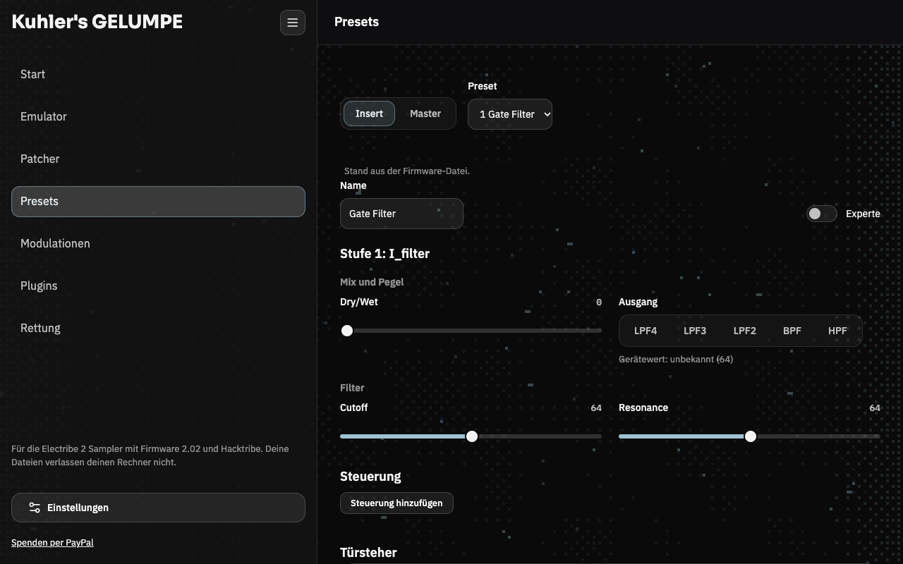
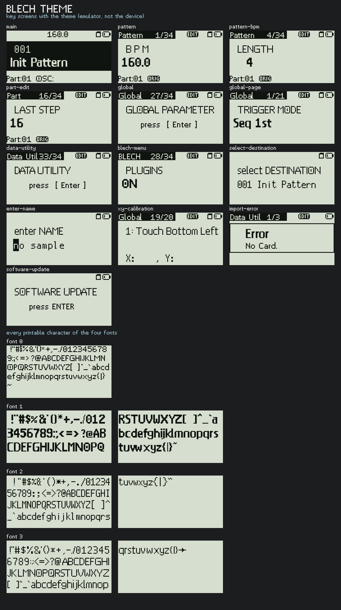

<picture>
  <source media="(prefers-color-scheme: dark)" srcset="assets/readme/banner-dark.svg">
  
</picture>

[English version](README.en.md)

Moin! GELUMPE ist ein Programm, mit dem du deine Electribe 2 auslesen und umbauen kannst. Mit drin
ist ein Emulator, also eine Electribe im Rechner, und ein Patcher für meine Firmware BLECH (ich nenn
sie auch gern "Blechtribe"). BLECH läuft auf dem roten Sampler, entweder über Hacktribe oder direkt
auf Korgs Original-Firmware. Für die blaue Electribe 2 gibt es inzwischen auch einen eigenen Satz, der
kann noch nicht alles, was die rote kann. Was genau geht und was nicht, steht in der
[Synth-Messung](docs/messungen/2026-10-16-blech-synth.md).

## Wer ich bin

Ich bin Kuhler Buhler, also Pascal, arbeite als Softwareentwickler und bin ein Live Act. Als ich Hacktribe installiert hab,
ist mir aufgefallen, dass man die MFX- und IFX-Presets ja selbst bearbeiten kann. Tja, und dann war ich
ein paar Monate in einer Entwicklungspsychose, und das hier ist dabei rausgekommen.

Warum das Ganze? Mich nervt, was Korg aus der Electribe 2 gemacht hat, nämlich nix. Da ist so viel mehr
drin, als Korg jemals rausgeholt hat. Mit BLECH hab ich mir praktisch die Electribe 3 gebaut, die es
nie gab.

Wenn dir das was bringt, freu ich mich über eine [Spende per PayPal](https://www.paypal.me/kuhlerbuhler).

## Was du damit machen kannst

GELUMPE läuft als App oder im Browser und funktioniert mit dem Electribe 2 Sampler mit Firmware
2.02, egal ob Korgs Original oder [Hacktribe](https://github.com/bangcorrupt/hacktribe). Du kannst

- die Firmware deiner Electribe im **Emulator** starten und bedienen, mit Display, Tasten, Reglern
  und LEDs, ohne dass irgendwas an dein Gerät geht,
- deine `SYSTEM.VSB` **patchen** und daraus eine neue Firmware-Datei für die SD-Karte machen
  (BLECH, eigenes Startbild, zweiter Master-Effekt und einiges mehr),
- **Plugins** schreiben, die direkt auf der Electribe laufen, zum Beispiel ein Lauflicht, ein Spiel
  auf dem Display oder eine eigene Menüseite, oder fertige aus dem Katalog nehmen,
- Effekte und Patterns in Klartext mit echten Einheiten bearbeiten statt in Bytes und sie per Web MIDI
  ans Gerät schicken.

Bevor irgendwas ans Gerät geht, schauen ein Linter mit Regeln, die ich am echten Gerät abgeglichen hab,
und der Emulator drüber, ob die Electribe das voraussichtlich schluckt. Emulator, Patcher und Plugins
laufen mit Korgs Original 2.02 und mit Hacktribe 2.02. Nur der Effekt-Editor und das Schreiben ins RAM
über MIDI brauchen Hacktribe. Bei anderen Firmware-Ständen liegen die Adressen woanders, deshalb wird
ein unbekanntes Gerät oder eine unbekannte Datei nur gelesen und nie beschrieben.

**Firmware ist nicht dabei.** Du lädst deine eigene `SYSTEM.VSB`, und die bleibt auf deinem Rechner.
Nichts davon landet auf irgendeinem Server.

## Vorschau

Der Dunkelmodus der App. Der Emulator ist hier ohne Firmware zu sehen, das Display bleibt schwarz.

| | |
|---|---|
|  |  |
| Start | Patcher, die Prüfung im Emulator läuft |
|  |  |
| Preset-Editor | Plugin-Katalog |
|  |  |
| Plugin-Editor | Emulator |

## Die App laden

Auf der Releases-Seite dieses Repositories liegt die App für macOS (Apple Silicon, `.dmg`), Windows (`.exe`) und Linux (`.AppImage`, `.deb`). Die App startet den
Emulator-Dienst selbst und beendet ihn beim Schließen. Karte und Flash des Emulators liegen
in `~/.gelumpe`. Beim Start und alle paar Stunden prüft die App, ob es ein neueres Release
gibt, und zeigt dann oben "Neue Version verfügbar". Ein Klick öffnet die Release-Seite.

**Die App ist nicht signiert.** Unter macOS blockiert das System die geladene App. Einmal
freigeben:

```bash
xattr -dr com.apple.quarantine "/Applications/Kuhlers GELUMPE.app"
```

Unter Windows zeigt SmartScreen eine Warnung: "Weitere Informationen", dann "Trotzdem
ausführen".

## Schnellstart aus den Quellen

**Im Browser.** Du brauchst Node.js 20 oder neuer, für den Emulator Python 3.10 oder neuer.

```bash
npm ci
npm run setup:emu   # einmalig: Python-Umgebung mit Unicorn für den Emulator
npm start           # Seite und Emulator zusammen
```

`npm start` zeigt die Adresse an (standardmäßig `http://127.0.0.1:8737/`), die öffnest du im Browser.
Ohne Emulator reicht `npm run serve`, dann entfällt `setup:emu`. Für die Kommunikation mit dem Gerät
brauchst du Chrome oder Edge auf einem Desktopcomputer, die Seite nutzt Web MIDI mit SysEx, das Safari
nicht kann.

**Die App selbst bauen** (Tauri v2). Einmalig: Node 20+, Python 3.10+, Rust über `rustup` und
`cargo install tauri-cli --version "^2" --locked`. Dazu je nach System: unter macOS die Xcode Command
Line Tools, unter Windows die Visual Studio Build Tools mit "Desktop development with C++", unter Linux
`libwebkit2gtk-4.1-dev libgtk-3-dev libayatana-appindicator3-dev librsvg2-dev libssl-dev libxdo-dev
patchelf python3-venv`.

```bash
npm ci
npm run app:build -- --bundles dmg            # macOS
npm run app:build -- --bundles nsis           # Windows
npm run app:build -- --bundles appimage,deb   # Linux
```

Der Build baut die Seite, friert den Emulator-Dienst per PyInstaller zu einem Sidecar ein
(`npm run build:sidecar` macht nur das) und packt die App. Das Ergebnis liegt unter
`src-tauri/target/release/bundle/`: `dmg/*.dmg` (macOS), `nsis/*-setup.exe` (Windows),
`appimage/*.AppImage` und `deb/*.deb` (Linux). Gebaut wird auf dem jeweiligen System, quer geht
nicht. Mehr dazu (Intel-Mac, Windows auf ARM): [Entwicklung](docs/development.md).

## Die Firmware patchen

Auf der Seite "Patcher" ziehst du deine eigene `SYSTEM.VSB` rein (Korgs Original 2.02 für Sampler oder
Synth, oder Hacktribe 2.02), wählst die Patches aus und bekommst eine neue Datei. Bevor du die
runterladen kannst, bootet der Emulator sie und prüft, ob alles läuft: Hauptbildschirm, Update-Abfrage,
Startmodi, Notschalter. Das dauert ein paar Minuten, du siehst dabei, welche Gruppe gerade dran ist.
Danach zeigt dir die Seite, wie du die Datei aufs Gerät bekommst. Alle Patches und ihre Grenzen stehen in
[docs/patcher.md](docs/patcher.md). Wer ohne App patchen will, nimmt `BLECH.patch` oder die passende
`.bsdiff`-Datei aus dem Release, das steht da auch.

Was BLECH auf dem Sampler so mitbringt: ein eigenes Menü BLECH mit Plugins, Farben für Display und
LEDs, Patternwechsel erst nach Bestätigung, TAP Motion, den Notenassistenten im KEYBOARD-Modus, einen
Melodie-Generator (SHIFT + PART ERASE), Blechy als kleines Haustier, ein Startbild mit Ladebalken,
verständliche Meldungen statt "Unknown Error" beim Sample-Laden und Doom (SHIFT + TAP beim Einschalten,
zur Lizenz siehe [docs/doom-lizenz.md](docs/doom-lizenz.md)).

So sieht die Electribe mit dem BLECH-Theme aus (im Emulator):



## Plugins

Mit einem Plugin bringst du der Electribe was Neues bei. Es kommt über die SD-Karte in den Ordner
`KORG/blechtribe/Plugin/`. Geschrieben wird in einer abgespeckten Form von JavaScript, der Editor
übersetzt das in Bytecode für eine kleine VM in der Firmware. Wenn ein Plugin einen Fehler hat, wird
nur das Plugin abgeschaltet, die Electribe läuft normal weiter. Sprache, Ereignisse und Funktionen:
[docs/plugins.md](docs/plugins.md). Im Katalog liegen schon fertige Plugins: Set-Timer, BLECH Clicker,
Snake, Tetris, Game of Life, Pong, Simon und Mandelbrot.

## Der Emulator

Der Emulator lässt die echte Firmware auf deinem Rechner laufen, und die Seite zeigt dir dazu eine
bedienbare Electribe mit virtueller SD-Karte. Ton gibt es keinen, den Hörtest am Gerät ersetzt er also
nicht, aber du kannst alles ausprobieren, bevor es überhaupt in die Nähe deines Geräts kommt. Mehr dazu
in [docs/emulator.md](docs/emulator.md), die Tastenkombinationen der Firmware stehen in
[docs/tastenkombinationen.md](docs/tastenkombinationen.md).

## Sicherheit: bevor du etwas aufs Gerät spielst

Ein falscher Schreibzugriff oder eine fehlerhafte Firmware kann das Gerät hängen lassen. Darum:

- **Notschalter:** EXIT beim Einschalten halten. Dann läuft die Firmware ohne Patches, und über
  DATA UTILITY, SOFTWARE UPDATE lässt sich eine andere Firmware aufspielen. Das gilt nur für diesen
  Start.
- **Sichern, bevor du etwas änderst:** die SD-Karte (Samples, Patterns, die originale `SYSTEM.VSB`)
  und die Global-Einstellungen. Ausschalten und WRITE speichern, was gerade im RAM steht, schalte
  also bei einer Abweichung nicht aus.
- **Zurück:** die gesicherte Original-`SYSTEM.VSB` wieder aufspielen. Wie das geübt wurde, steht in
  [docs/messungen/2026-10-10-rueckweg-geuebt.md](docs/messungen/2026-10-10-rueckweg-geuebt.md).
- **Wenn das Gerät nicht mehr startet:** die Seite "Rettung" im Editor führt durch den dokumentierten
  Weg und sagt bei jedem Schritt, ob er am Gerät gemessen ist. Der Bootloader bleibt tabu, dahinter
  hilft nur JTAG ([docs/rettung.md](docs/rettung.md)).
- **Selbst testen:** die [Gerätetests](docs/geraetetests/README.md) beschreiben, wie du BLECH und die
  Kartenfunktionen an deinem Gerät nachvollziehst, mit Warnung, Voraussetzungen, Sicherung und
  Rückweg.

Der Linter prüft bekannte Speicherbereiche, das Nachrichtenformat und dokumentierte Fehlerfälle. Der
Emulator führt den echten ARM-Code der Firmware aus, den DSP aber nur als Attrappe: er erzeugt keinen Ton,
und das Bedienfeld und das Timing bildet er nur nach. Ob etwas gut klingt, sagt nur das Gehör. Vieles ist
bisher nur im Emulator geprüft und am echten Gerät noch nicht. Details: [docs/linter.md](docs/linter.md),
[docs/emulator.md](docs/emulator.md).

## Dokumentation

[docs/README.md](docs/README.md) ist der Index: Plugins, Patcher, Emulator, Gerätekarte, die Messungen
am Gerät, Ideen und Hintergrund. Für die Arbeit am Code: [docs/development.md](docs/development.md).

An diesem Projekt arbeiten auch KI-Agenten mit. Die Regeln für sie stehen in [AGENTS.md](AGENTS.md).

## Mitmachen

Pull Requests gehen gegen `develop`, nicht gegen `main`. Die Regeln stehen in [CONTRIBUTING.md](CONTRIBUTING.md); die
wichtigste: keine Korg-Daten ins Repository, nie. Ein Check schließt einen Pull Request, der welche enthält. Wer etwas
findet, das ein Gerät beschädigen kann, meldet es privat ([SECURITY.md](SECURITY.md)).

## Lizenz

AGPL-3.0, siehe [`LICENSE`](LICENSE). Die Herkunft der Bestandteile steht in [`NOTICE`](NOTICE).
