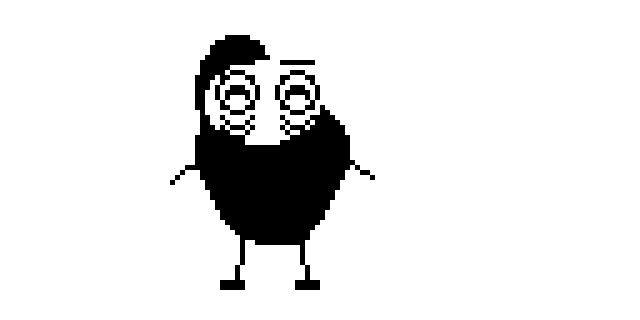
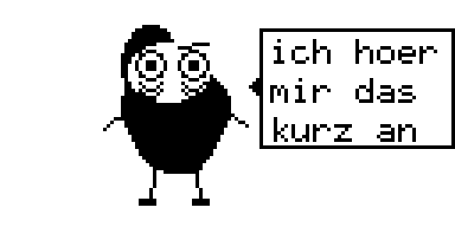
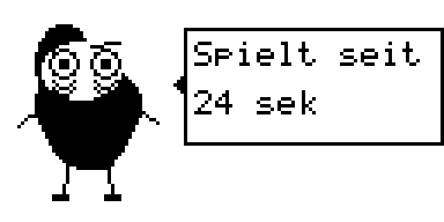
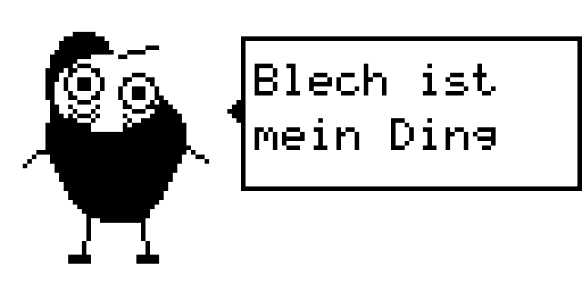
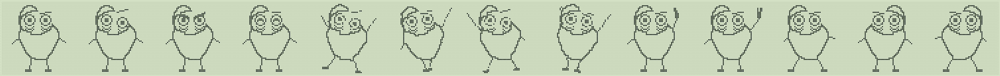

# Blechy in BLECH eingebaut: die letzte Seite des Rings

Stand 2026-10-15. Kein Gerätezugriff. Gemessen sind Verhalten und Zeit im Emulator. Blechy war zuerst ein Spiel unter GAMES
(ein Plugin von der Karte); jetzt ist er in BLECH eingebaut und hat die letzte Seite des EDIT Rings der Firmware. Wie das Menü
den Ring erweitert: [BLECH Menü](2026-10-14-blech-menue.md). Anwendersicht: [Plugins](../plugins.md), Abschnitt "Blechy, die
letzte Seite des Rings".

## Was gebaut ist

Die Seite liegt hinter Event und vor dem Pattern Menü ("31/31"). Sie ist Ebene 3 des BLECH Bildschirms (`M_LEVEL_BLECHY`), kein
eigener Bildschirm: der Bildschirm 0x2D zeichnet dabei keine Texte (Titel, Wert, dritte Zeile bleiben leer), das ganze Display
kommt von Blechy.

| Was | Wie |
|---|---|
| Hinweg | EDIT rechts auf Event: der Haken `menu_event_right` an `0xC0064430` (die erste Anweisung der Klassenstelle von Event) schaltet bei scharfem Menü auf 0x2D mit Ebene 3 |
| Weiter | EDIT rechts auf der Seite: `menu_next_pattern` führt den verdrängten Befehl aus und springt hinter ihn (`0xC0064434`), also genau der Weg, den Event sonst geht (Pattern Menü, erste Seite) |
| Zurück | EDIT links auf der Seite: Event (10). EDIT links auf der ersten Pattern Seite: der Haken `menu_pattern_left` an `0xC0067754` (`mov r0, #10`) schaltet auf die Seite |
| Zähler | die Haken des Seitenzählers addieren eine Seite (`MENU_RING_TAIL`): Global 27/31, BLECH 28/31, Data Util 29/31, Event 30/31, Blechy 31/31 (nicht sichtbar) |
| Block | `data/script/blechy-block.hex`, gebaut von `tools/blechy-build.mjs` (übersetzt, im Browser mit den aufgezeichneten Eingaben geprüft, als geprüft markiert), im Abbild bei `0xC0184000`, 15476 Byte |
| Laden | `blechy_boot` (`tools/patch/script_builtin.s`) im Haken des Kartenladers, vor dem Lesen der Karte: Laufzeit aufsetzen, Block laden (`script_load_block_ex`: der Block bleibt im Abbild, nur Eintrag und Variablen kommen in den Pool), als App 0 in der Gruppe `BUILTIN` eintragen (kein Menü listet sie), Rumpf starten, Laufzeit scharf. Ohne Karte und ohne Datei |
| Öffnen, Schließen | `blechy_follow` im Rahmenhaken, einmal je Rahmen: zeigt die Firmware 0x2D mit Ebene 3, wird er mit `script_app_open` geöffnet (`open`, Display), zeigt sie etwas anderes, mit `script_app_close` geschlossen (`close`). Das Display wird auf der Seite wie auf dem Hauptbildschirm über das Bild der Firmware kopiert |
| Eingaben | auf der Seite gehen nur die Taste Touchpad und die Lage an die Plugins, alles an die Firmware, und nichts wird verschluckt: EDIT und EXIT funktionieren immer |
| Nicht in Listen | wer ihn von einem Plugin der Karte unterscheiden muss (PLUGINS Seiten, Zählung, EXPORT ALL, Speicher der Werte, LED Halten), fragt, ob der Block unterhalb des Pools liegt |

## Bilder und Verhalten

Der Quelltext ist `data/script/blechy-source.mjs`, gebaut von `tools/blechy-build.mjs` aus den Sprites in `assets/blechy/sprites/`
(56 mal 56, 1 Bit, `tools/art/make_blechy.py`), der Tabelle `data/script/blechy-art.mjs` (welcher Frame welches Sprite zeigt und wo)
und dem Verhalten (`data/script/blechy-logic.mjs`). Er ist kein Beispiel-Plugin mehr (nicht im Editor, nicht in den Plugin-Paketen).

| Zustand | Auslöser | Sprite |
|---|---|---|
| stehen | auf der Seite, dazwischen zuckt er (160 ms, alle 1,5 bis 4 s) | `calm`, beim Zucken `idle` |
| winken | etwa eine Sekunde nach der Landung, einmal je Landung, die Hand wechselt alle 220 ms, 1,76 s lang | `wave-1`, `wave-2` im Wechsel |
| gehen | nach dem Winken: ein Pixel alle 120 ms zwischen den Rändern, eine Sekunde Halt am Rand. Alle 240 ms wechselt das Bild (das Gehbild eine Zeile tiefer), nach links gespiegelt | `calm` und `walk`, links `back0` und `back1` (die beiden gespiegelt) |
| reden | am Rand, wenn die Zeit um ist (zuerst nach gut 12 s, danach alle 8 s plus 0 bis 8 s plus Weg): Sprechblase 3,5 s, acht Zeilen der Reihe nach, auf der Seite mit Platz | `calm` |
| wütend | Antippen nahe an ihm, wo er steht (1,2 s) | `angry` |
| froh | Streicheln, Wischen nahe an ihm (1,6 s) | `happy` |
| PLAY | zügig in die Mitte (zwei Pixel alle 70 ms, Ziel 24 Pixel rechts vom Stand), "ich hoer mir das kurz an" (2,8 s), dann Tanz | `calm` und `walk` im Wechsel, `calm` |
| Tanz | nach dem Zuhören, solange es spielt, ein Bild je `step` mit gerader Zahl (also je Achtel) | `terror-1` bis `terror-4` |

Die Wartezeit von einer Sekunde und die Schwingzeit von 220 ms sind eine Wahl, am Gerät nicht erprobt. Reihenfolge, wenn
mehrere Auslöser zusammenfallen: Reaktion (wütend, froh), die Zustände nach PLAY, Winken, Halt, Gehen, Zucken, Stehen. Wer ihn in der Wartezeit antippt,
bekommt erst den Ärger und danach den Gruß. `blechy-wave-1.png` und `blechy-wave-2.png` sind die ruhige Pose (`calm`) mit
erhobenem rechten Arm, die Hand neigt sich links, dann rechts; alle anderen Sprites sind Byte für Byte die alten (geprüft gegen
die neu erzeugten). Die beiden Winkbilder gehören zur Familie der Standbilder: das Werkzeug zeichnet ihr Gemeinsames einmal und
tauscht beim Wechsel nur das Rechteck, in dem sie sich unterscheiden.

`idle`, `walk` und `terror-1` bis `terror-4` sind die vorgegebenen Sprites, `walk` ist jetzt das Gehbild. `calm` (ohne Zucken),
`angry` und `happy` sind aus der Idle-Pose abgeleitet, es ändert sich nur das Gesicht, Blechy hat keinen Mund.

Winken im Emulator (Display-RAM der Seite, nur Blechys Bild, kein Text der Firmware):

| | |
|---|---|
| Hand links |  |
| Hand rechts |  |

## Messungen

| Was | Wert | Art |
|---|---|---|
| Block | 15476 Byte, davon 13063 Byte Code (Limit 16384), 57 Zahlen über 255 (Limit 256), 25 Texte (Limit 64), 3903 Variablenplätze (vorher, mit Winken, ohne Gehen und Reden: 12668 Byte, 11285 Byte Code, 46, 9, 2389) | gemessen (`tools/blechy-build.mjs`, `test/script-blechy.test.mjs`) |
| Speicher im Pool | Eintrag (292 Byte) und Variablen (15612 Byte): 15904 Byte von 131072. Der Block selbst liegt außerhalb | gemessen (`test_a_block_can_stay_outside_the_pool`) |
| Platz im Abbild | `0xC0184000` bis `0xC0187C74` (15476 Byte, Platz bis `0xC0188000`, 908 Byte bleiben), im FF Lauf `0xC01720B0` bis `0xC01A0000`, in dem die unveränderte Firmware im Emulator kein Byte beschreibt ([Patcher](../patcher.md), Speicherorte) | gemessen im Emulator, am Gerät ungeprüft |
| Kosten des teuersten Rahmens, Browsermodell | 3205 von 20000 Einheiten | gemessen (`SimDevice.status()` über die aufgezeichneten Eingaben) |
| Zeit des teuersten `frame`, Emulator | 0,40 ms (Timer3), weit unter dem Rahmenbudget von 5 ms | gemessen (`blechy_cases.py`) |
| Zeit der übrigen Handler, Emulator | 0,10 ms bei Tasten, Touch und `step` | gemessen, vermutlich der Boden durch Unterbrechungen (Snake zeigt 0,103 ms) |
| Start | `blechy_boot` rund 5,44 Millionen Befehle: 70 % das byteweise Nullen (`mem_fill`: Laufzeit 166864 Byte und die Prüftabellen), 8 % die Prüfsumme, rund 5 % die Zerlegung der Befehle | gezählt im Emulator; Zeit am Gerät geschätzt, einige zehn Millisekunden |
| Zeit am Gerät | etwa 1,3 bis 1,6 mal der Emulatorwert ([VM-Tempo](2026-10-12-vm-tempo.md)) | hergeleitet |

Das Laufzeitgebiet wuchs um 12 Byte (ein Platz mehr in der App Tabelle: 8 Plätze für Plugins, einer für ihn, `SCRIPT_APPS`
in `data/script/contract.mjs`): von 166852 auf 166864 Byte, es endet 0x30 Byte vor den Menüeinträgen bei `0xC01D6C00`. Nichts
musste verschoben werden: der neue Code (1,1 KiB Platz übrig bis `0xC01ADE00`) liegt hinter dem Menü Code im Codebereich.

## Im Emulator geprüft

`tools/emu/blechy_cases.py` über `test/emulator-blechy.test.mjs`, mit dem Flash Abbild und **ohne Karte**, dazu
`tools/emu/menu_cases.py` (`blechy_ring_cases`, `check.py` ruft sie) und die Fälle in `tools/emu/script_cases.py` (`karte-*`,
`menu-*`, `import-*` mit Blechy als erstem Eintrag der Laufzeit):

- **Laden:** ohne Karte ist die Laufzeit scharf, sein Eintrag ARMED, der Block liegt im Abbild und nicht im Pool, die Plugin
  Seiten zählen ihn nicht, geschlossen zeichnet er nichts (das Display ist das eines Geräts mit EXIT beim Einschalten).
- **Ring:** Event rechts ergibt die Seite (Zähler 31/31, geöffnet, sein Bild allein auf dem Display), rechts weiter ins Pattern
  Menü, dort links wieder auf die Seite, links weiter nach Event, EXIT zum Hauptbildschirm (geschlossen), das Hauptrad, MENU und
  WRITE ändern nichts (die Karte bleibt unverändert), 48 Tasten auf der Seite ohne Assertion.
- **Winken:** nicht vor etwa 0,9 s, die Hand schwingt 6 bis 10 Mal in 1,5 bis 2,1 s, beide Bilder verschieden, danach steht er; kein
  zweites Winken in 6 s; nach Weg und Zurück winkt er wieder.
- **Gehen:** er geht ein Pixel nach dem anderen (nie mehr als drei Pixel zwischen zwei Blicken im Abstand von 0,2 s), sein Ort
  ändert sich über die Seite. Das Bild wechselt etwa alle 240 ms (Median zwischen 180 und 300 ms), nach rechts `calm` und `walk`,
  nach links `back0` und `back1`; je ein Bild aus dem Display-RAM (rechts ruhig, rechts Gehbild, die Wende am Rand, links ruhig,
  links Gehbild) ist Punkt für Punkt das, was der Bauer aus den Sprites macht, am Ort und in der Zeile, an der er steht
  (`test/emulator-blechy.test.mjs`).
- **Reden:** er bleibt an einem Rand stehen und redet (in 90 s Gerätezeit zweimal, von selbst), die Blase auf der Seite mit Platz;
  im Browsermodell dazu die Rotation der Texte, der Abstand von mindestens 12 s und beide Seiten.
- **PLAY:** der Sequencer startet (die Firmware bekommt die Taste), er geht in die Mitte (Ort 24), die Blase "ich hoer mir das kurz an"
  steht, dann tanzt er in der Mitte, die Tanzbilder wechseln mit den Steps; STOP stoppt den Sequencer, er geht wieder, keine Blase.
- **Wie vorher:** Antippen (dort, wo er steht) wütend, Streicheln froh, EXIT schließt.
- **EXIT beim Einschalten:** die Laufzeit ist nicht aufgesetzt (`0xFFFFFFFF`), der Ring ist der der Firmware (Event rechts geht
  direkt ins Pattern Menü, 28/29 bei Data Util), die Seite fehlt (`menu:exit_held_has_no_blechy_page`).
- **Einheiten:** `tools/patch/test_script_hooks.py` (Laden außerhalb des Pools, Anmeldung, Öffnen und Schließen, keine Listen,
  Eingaben), `test_script_card.py`, `test_script_store.py`, `test_script_hw.py`.

Bilder aus dem Display-RAM (aus dem Lauf auf der Seite):

| | |
|---|---|
| stehen |  |
| wütend |  |
| froh |  |
| Tanz |     |
| gehen |  |
| Gang (aus dem Bauer, nicht aus dem Display-RAM): rechts zweimal ruhig und Gehbild, links zweimal gespiegelt |  |
| PLAY, zuhören |  |
| reden |   |

Alle Frames der Tabelle nebeneinander: 

Im Browsermodell prüft `test/script-blechy.test.mjs` jedes Bild Pixel für Pixel gegen die Sprites (die Wechsel unter den
Standbildern ergeben dasselbe Bild wie ein ganzes Neuzeichnen), das Winken (Beginn, Dauer, Schwünge, einmal je Landung, nach dem
Ärger) und die Probe mit aufgezeichneten Touch- und Transport-Eingaben (`test/support/blechy-inputs.mjs`): kein Fehler, jede
Zeile läuft.

## Was die Schnittstelle nicht konnte (API 6 löst es)

- **Tasten der offenen App:** PLAY, STOP und REC reichen bis zur Firmware, auch bei offener App, und die App sieht sie ebenfalls.
  Blechy reicht nichts mehr selbst weiter. Auf seiner Seite geht ohnehin alles an die Firmware.
- **Bild aus Daten:** `korg.display.bitmap(feld, x, y, breite)`, ein Aufruf je Bild; die Daten kosten trotzdem Code, solange es
  keinen Befehl gibt, der ein Feld in einem Zug füllt (9 Byte je Platz ungleich 0).
- **Touchpad:** `touch` trägt als dritten Wert `first`. Die Panel-Nachricht `05 xh xl yh yl` kommt als `x = xh * 256 + xl`,
  `y = yh * 256 + yl` an, ungeklemmt; die Taste 34 hat keine Lage. Die Abbildung Pad auf Display bleibt angenommen (`x / 8` gleich
  Display-Spalte), am Gerät nicht geprüft.
- **Text mit Zahl:** `korg.display.textNumber(text, wert, x, y)`.
- **Töne:** Plugins spielen keine Samples, Blechy bleibt stumm.

## Am Gerät offen

Alles: die Zeit, die Lage des Touchpads, ob die Weitergabe der Transporttasten dort genauso wirkt, wie das LCD bei Achtelwechseln
aussieht (geschätzt träge, grob 100 ms), ob der Platz bei `0xC0184000` am Gerät frei bleibt (der Lauf davor ist nur im Emulator
gelesen, [Geräteprüfung](../geraetetests/blech-datei.md)), die Dauer des Starts, und wie sich die Wartezeit von einer Sekunde vor dem
Winken anfühlt.
