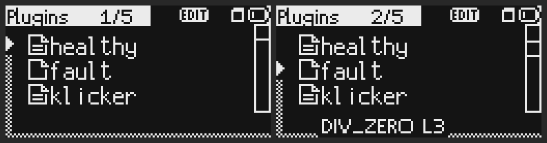
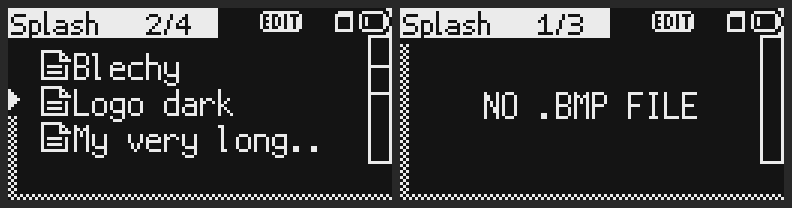

# Plugin-Liste und SPLASH IMPORT als Dateibrowser

Stand 8. November 2026. **Gemessen** im Emulator mit Hacktribe 2.02 (eigene Datei), Korgs Original 2.02 rot und blau, jeweils
mit dem BLECH-Satz. Code: `tools/patch/script_menu.s` (`menu_brw_fill`, `menu_brw_draw`). Fälle: `menu:splash_browser_empty` und
`menu:splash_browser_like_import_sample` in `tools/emu/menu_cases.py`, die Plugin-Liste in `tools/emu/script_cases.py`. **Am Gerät nicht geprüft.**

## Frage

Die Liste von BLECH > PLUGINS zeigte ein Plugin je Seite (Name, darunter ON, OFF oder der Fehler), SPLASH IMPORT eine Datei je
Seite. Lassen sich beide so zeichnen wie der Dateibrowser der Firmware (DATA UTILITY, IMPORT SAMPLE), mit den Zeichenfunktionen
der Firmware selbst, ohne dass sich an Tasten, Rad und Zustand etwas ändert?

## Weg

Den Browser der Firmware offline gelesen (Liste `0xC0085BB4`, Cursor `0xC0085B0C`, Bildlaufleiste `0xC0085A0C`) und im
Emulator nachgezeichnet. Ein eigenes Widget, das letzte des Bildschirms, zeichnet die drei Zeilen über die Textzeilen der Seite.
Die Textzeilen bekommen einen leeren Text, behalten ihren Inhalt aber im Speicher, damit alle Fälle weiter lesen können, was die
Seite sagt. Verglichen wurde Pixel für Pixel: IMPORT SAMPLE mit fünf `.wav` und dem Ordner `KORG` gegen SPLASH IMPORT mit
`KORG.bmp` und denselben fünf Namen als `.bmp`, Zeilen 10 bis 63 (der Kopf unterscheidet sich im Schild).

## Ergebnisse

| Befund | Marker |
|---|---|
| SPLASH IMPORT gegen IMPORT SAMPLE, Rad 4 und 5 Schritte: 0 Pixel verschieden, auf Hacktribe und rot | gemessen |
| Rad 0 und 2 Schritte: nur das Symbol der Zeile `KORG` weicht ab (die Firmware zeigt dort das Ordnersymbol, bei uns ist es eine Datei), 14 und 32 Pixel in x 11 bis 23, y 11 bis 20; Namen, Cursor und Bildlaufleiste gleich | gemessen |
| Drei Zeilen in großer Schrift, Dateisymbol vor dem Namen, Name ohne Endung, länger als 14 Zeichen: 12 Zeichen und ".." wie die Firmware | gemessen |
| Cursor: das Dreieck links, die Liste bleibt stehen, bis der Cursor die drei Zeilen verlassen würde. Bildlaufleiste wie die Firmware (Höhe 43/n, mindestens 2, ab vier Einträgen) | gemessen |
| Der Zähler im Kopf zählt in SPLASH IMPORT die Dateien (1/5 bis 5/5, das Rad hält an der letzten); ohne Datei bleibt der Zähler der Seiten | gemessen |
| SPLASH IMPORT ohne Datei: NO .BMP FILE in der Mitte, sonst kein Text | gemessen |
| SPLASH IMPORT, langer Name (`a-very-long-name-here.bmp`): die Zeile zeigt `a-very-long..`, die Schrift endet bei x 102, die Bildlaufleiste beginnt bei x 120; die Zeilen überlappen nicht | gemessen |
| Nach jedem Schritt (Rad, ENTER, von SPLASH DRAW zurück) gleicht alles unter dem Schild der Seite, die auf leerem Bild neu gezeichnet wird: 0 Pixel übrig, 0 fehlen (`menu:splash_no_file_value_clean`, `menu:splash_list_value_clean`, `menu:splash_long_name_cut`); ein absichtlich gesetztes Byte fällt mit 8 Pixeln auf | gemessen |
| Plugin-Liste: Zähler, EDIT, Rad, ENTER und EXIT wie vorher; die Fälle der Liste in `script_cases.py` laufen unverändert | gemessen |
| Auf blau zeichnet die Plugin-Liste genauso, ohne das Muster des BLECH-Themas am Rand. SPLASH IMPORT gibt es dort nicht (kein Startbild-Editor) | gemessen |

## Zustand eines Plugins

ON und OFF standen vorher als Wort in der zweiten Zeile. Im Browser ist dafür kein Platz, darum zeigt es das Symbol: ein Blatt mit
zwei Linien heißt, das Plugin läuft, ein leeres Blatt heißt, es läuft nicht (ausgeschaltet, nicht geladen oder mit Fehler). Was die
Zeile darüber hinaus sagte (`DIV_ZERO L3`, WRITE=ALLOW, was getan wurde), steht für das gewählte Plugin klein unter den drei Zeilen.

## Speicher

Der Browser liegt in MENU_STATE ab 0x118 (Zeilen, Zahl, Auswahl, oberste Zeile, an/aus) und 0x160 bis 0x1AF (Vtable des Widgets,
Zeile unter den Zeilen). Key Pads belegt 0x108 bis 0x113; eine erste Fassung lag dort und rief das Fenster KEY der Firmware auf.

## Offen

- **Am Gerät**: keine Zeile.
- **Ordner**: SPLASH IMPORT kennt keine Unterordner, darum gibt es das Ordnersymbol nie.
