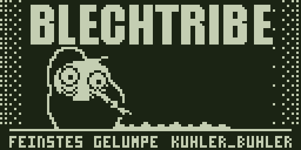
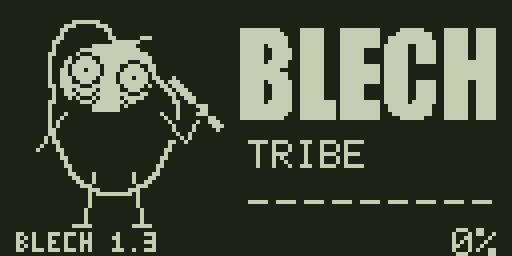
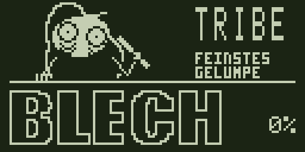
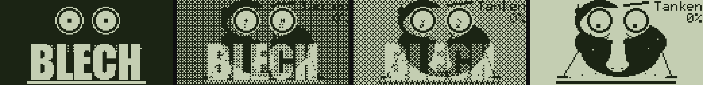
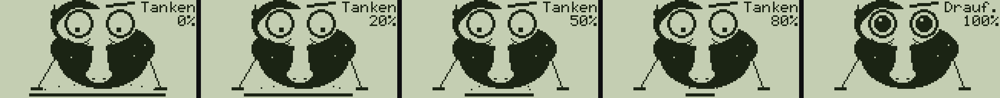
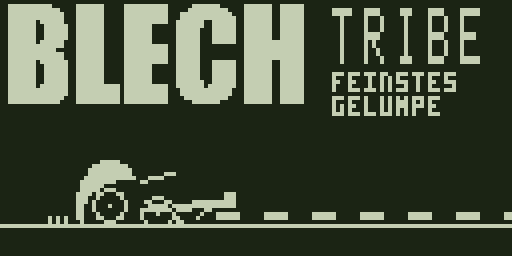
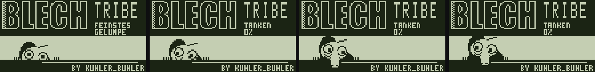
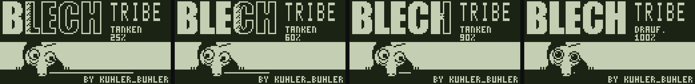

# Design 1.3: Entwürfe

Entwürfe für das Release 1.3, zum Umsetzen durch eine andere Session. Nichts hier ist eingebaut. Die Seite
`site/` und die Patches in `data/patches/` sind unverändert.

- **Web:** `web/index.html`, klickbare Entwürfe mit den echten Tokens aus `site/design/`. Ansehen:
  `python3 -m http.server 8742` im Repo-Ordner, dann `http://127.0.0.1:8742/entwuerfe/design-1.3/web/`.
  Unten die Leiste schaltet zwischen den Entwürfen. Klassen mit `cee-` sind als echte Namen für `site/app.css`
  gedacht, `mk-` rahmt nur den Entwurf.
- **Gerät:** `geraet/`, Bilder für das Display (128 mal 64, 1 Bit). `png/` im Format von `assets/blechy/`
  (schwarz = gesetztes Bit), `vorschau/` 4fach auf LCD-Farbe. Neu erzeugen:
  `python3 entwuerfe/design-1.3/geraet/render.py`. Der Renderer nutzt nur eigene Kunst: `assets/blechy/splash.bin`,
  die Blechy-Sprites und die Schrift `data/script/font.mjs`.

## Befund (Stand 19.10., ohne geladene Firmware angesehen, 1440 mal 900)

Gemessen heißt hier: im Browser angesehen. Was mit geladener VSB anders aussieht, ist aus dem Code gelesen.

| # | Schwere | Befund | Wo |
|---|---|---|---|
| 1 | hoch | **Presets ist ohne Firmware eine komplett schwarze Fläche**, kein Text, keine Aktion. Modulationen zeigt einen Satz in Grau. | `#fx`, `#mod`; Leertext `idle` in `site/app/main.mjs` |
| 2 | hoch | **Die Firmware wählt man nur im Emulator**, in einem zugeklappten Block der Seitenleiste. Presets, Modulationen und Patcher hängen daran, sagen es aber nicht. Der Patcher hat zusätzlich ein eigenes Dropzone-Feld. Man sieht nirgends, was gerade geladen ist. | `options.add("emu", ...)`, `patcher.mjs` |
| 3 | hoch | **Kein globaler Zustand:** Firmware, Karte, Emulator, Gerät stehen verstreut (Emulator oben links "nicht verbunden", Navbar rechts leer). | `cee-navbar`, `cee-nav-state` |
| 4 | mittel | Start ist eine lange Textseite. Das Wichtigste (was tun, wo anfangen) steht nach drei Absätzen über das Projekt. Die Karten "Was man damit machen kann" sind nicht klickbar. | `#cee-start-page` |
| 5 | mittel | Seitenleiste: 9 gleich gewichtete Einträge ohne Gruppen und ohne Symbole, darunter viel Leere. Rettung steht zwischen normalen Bereichen. | `index.html` Tablist |
| 6 | mittel | Der Emulator zeigt aus ein schwarzes Display. Der Start-Befehl steht als graue Zeile oben, nicht kopierbar. | `#emu` |
| 7 | mittel | Patcher und Startbild: ein Dropzone-Feld, rechts davon nichts. Kein Weg sichtbar (Firmware, Patches, Emulator, Datei). | `#patcher`, `#splash` |
| 8 | mittel | Gerät: Startbild und Ladebild sind fast dasselbe Bild (BLECH, offene Augen, Unterstrich). Man sieht nicht, wann das Laden anfängt. Das geditherte "Kuhler's" erkennt man nicht. | `assets/blechy/splash.png`, `load-bar` |
| 9 | niedrig | Einstellungen: zwei Schalter. Man kann fast nichts anpassen. | `site/app/settings.mjs` |
| 10 | niedrig | Plugins: zwei gleich starke Knöpfe je Karte ("Code ansehen", "Download .blech"), keine Filter. Sonst die beste Seite. | `#scripts` |

## Die Entwürfe

### 1. Werkbank (auf jeder Seite)

Oben rechts vier Chips: **Firmware, Karte, Emulator, Gerät**, je Punkt und Wort (DESIGN.md: Status nie nur über
Farbe). Klick führt dahin, wo man es ändert. Die Firmware wird einmal gewählt und gilt für alle Bereiche; der Block
"Firmware (VSB)" in der Seitenleiste des Emulators fällt weg. Auf schmalen Bildschirmen nur Punkt und Wert.

### 2. Seitenleiste mit Gruppen

Start, dann **Gerät** (Emulator, Echtes Gerät), **Firmware** (Patcher, Bildschirme, Plugins), **Sound** (Presets,
Modulationen, Pattern-Werkzeuge, Samples). Unten abgesetzt Rettung (rot), Einstellungen, Spenden. Jeder Eintrag mit
Stroke-Symbol; kleine Marken rechts: `VSB` gestrichelt, wenn der Bereich eine Firmware braucht und keine da ist,
`Labs`, `USB`. Oben ein kleiner Blechy neben dem Namen (Sprite `blechy-calm`, abschaltbar).

"Startbild" heißt neu **Bildschirme**, weil es jetzt drei Bildschirme sind.

### 3. Start als Einstieg

Held mit Spruch und zwei Aktionen, rechts das echte Display (live aus dem Emulator, sonst ein Bild). Darunter drei
Schritte, die aus der Werkbank gefüllt werden (erledigt, als nächstes). Dann die Bereiche als Kacheln mit Stern zum
Anheften, angeheftete stehen breit vorne. Rettung als schmale rote Leiste. Der Text über das Projekt bleibt, rutscht
aber nach unten in zwei Spalten.

### 4. Leerzustand für alles, was eine VSB braucht

Ein Muster für Presets, Modulationen, Pattern-Werkzeuge, Samples: Display mit Blechy, ein Satz in seinem Ton, was
gebraucht wird (Pillen), Aktion direkt hier (Datei wählen öffnet sofort den Dateidialog, "Vom Gerät holen", "Was ist
eine VSB?"). Darunter blass der Umriss dessen, was nach dem Laden kommt. Umsetzung über `ui.state` mit `kind: "empty"`
plus das Display-Bild.

### 5. Patcher als Weg

Vier Schritte als Leiste. Patches als Karten in Gruppen (Bildschirme, Spielen, Werkzeuge, Unter der Haube) mit
Schalter und Belegen als Pillen ("Emulator", "Gerät" oder "Gerät offen"), Filter für Sätze (BLECH, Alles, nur am Gerät
geprüft, eigene Auswahl). Rechts klebt die Zusammenfassung: Display-Vorschau mit Umschalter Start, Laden, Aus; Zahlen
(Patches, am Gerät gesehen, freier Platz, Startzeit) in Mono; eine Hauptaktion "Im Emulator booten", erst danach
"SYSTEM.VSB holen".

### 6. Bildschirme

Drei Karten: Start, Laden, Aus. Je Karte ein großes Display und Varianten zum Anklicken, darunter die Abläufe als
Filmstreifen. Eigenes Bild hochladen bleibt (heute die einzige Funktion der Seite).

### 7. Emulator aus

Das Display zeigt den schlafenden Blechy statt Schwarz. Rechts eine Karte: Befehl `npm run emu` mit Kopierknopf, die
zwei Dateien (SYSTEM.VSB fehlt, SD-Karte optional), ein Knopf zum Verbinden.

### 8. Einstellungen als Seite

Gruppen Darstellung, Startseite, Blechy, Gerät und Sicherheit, Daten. Neu anpassbar:

| Einstellung | Was | Regel aus DESIGN.md |
|---|---|---|
| Displayfarbe | Farbe aller Display-Vorschauen und des Emulators (wie das Gerät, Eis, Rot, Weiß) | ein Farbschema bleibt; das betrifft nur das LCD |
| Dichte | Kompakt oder Normal (Zeilenhöhen, Abstände) | Tipp-Flächen bleiben 44px |
| Augen im Hintergrund | das Easter Egg aus `bg.js`, heute nur per `?bg-eyes=off` | |
| Seitenleiste | mit Gruppen oder nur Symbole | |
| Beim Öffnen | Start, zuletzt offener Bereich, Emulator | |
| Reihenfolge und Anheften der Bereiche auf Start | | Stern direkt an der Kachel, kein Bearbeiten-Modus |
| Blechy in der Seitenleiste, Töne, Sprüche | | |
| Vor jedem Senden fragen, Labs zeigen | "Erst im Emulator" bleibt immer an | |

Alles in `localStorage` wie heute (`cee.settings`), ein Eintrag je Feld in `FIELDS`.

### 9. Plugins

Wenig: Filter (Alle, Spiele, Werkzeuge, Meine), je Karte eine Hauptaktion "Im Emulator starten", Download als
zweiter Knopf, Code ansehen als Link.

## Gerät

### Aktuell: Werkbank mit höchstens 5 FPS

Die Werkbank behält ihre Gestaltung. Neue Bewegung als Schleife: Blechy zieht die Line von links nach rechts weg,
bleibt rechts stehen, dann Schnitt und links liegt eine neue Line. **Höchstens fünf Bilder pro Sekunde**, jedes
Bild mindestens 200 ms. Eine eigene Schleife zeigt nur die Bewegung bei festen 42 Prozent.

[Bewegung einzeln ansehen](geraet/vorschau/neu/werkbank-loop-5fps.gif),
[Vergleich öffnen](geraet/vergleich.html), [Ablauf und Export](geraet/README.md).

### Layoutstudien: Werkbank, Typenschild, Prägung

Der aktuelle Vergleich liegt in [geraet/vergleich.html](geraet/vergleich.html). Drei GIFs zeigen verschiedene
Aufteilungen mit demselben Blechy, dunklem Grund und stufenweise wachsenden Pupillen. Die aktuelle Werkbank behält
die Handlung an einer festen Line; beim Typenschild steht die vollständige Figur neben der Marke; bei Prägung füllt sich BLECH.
Röhrchen, Griff und Arm haben jetzt eine gemeinsame Geometrie. Das helle Originalgesicht bleibt erhalten.

[Ansehen, neu rendern und technische Grenzen](geraet/README.md). Erzeugt mit `python3 entwuerfe/design-1.3/geraet/anim.py`.
Die alten Entwürfe darunter bleiben als Vergleich erhalten. Eine Richtung ist noch nicht ausgewählt; nichts davon
ist in die Firmware eingebaut.

### Vorige Stände

Abgestimmt am 19.10. Was nicht mehr gilt (schlafender Start, Markenbild, Balken mit mitlaufenden Augen), liegt in
`geraet/verworfen/`.

### Rotzen (Stand 19.10., voriger Vorschlag, Animation)

Erzeugt vom vorigen `geraet/anim.py`; der neue Renderer schreibt die drei Richtungen nach `vorschau/neu/`.

- **Dunkelmodus als Standard:** der ganze Schirm ist gesetzt (dunkel), gemalt werden nur helle Pixel. Am Gerät
  beobachtet: ein Pixel kurz aus und wieder an schmiert weniger als an und wieder aus, Bewegung wirkt so schärfer.
  Darum ist alles hell auf dunkel, auch Blechy (das Sprite invertiert: Körper hell, Gesicht dunkel, Pupillen hell).
  Die Invert-Option der Firmware wird Standard. Wie viel Bilder pro Sekunde das LCD dann sauber zeigt: **am Gerät
  prüfen**, der Entwurf läuft mit rund 11.
- **Oben bleibt BLECH stehen.** TRIBE und FEINSTES GELUMPE bleiben noch für die ersten zwei Striche, dann rutschen sie
  nach links hinter BLECH weg, LADEN kommt von rechts und bleibt stehen, darunter die Prozentzahl (noch nicht
  gestaltet).
- **Fortschritt sind kurze, gleich lange Striche auf dem Tisch** (10 Stück, 6 Pixel, alle 12 Pixel), auf Nasenhöhe.
- **Ein Strich, eine Schleife:** Blechy hat das Röhrchen immer in der rechten Hand, die linke liegt auf dem Tisch.
  Das Röhrchen hat eine feste Länge. Röhrchen an die Nase, dann fährt er schnell den Strich entlang (die Welt rückt in
  2-Pixel-Schritten nach links, was die Spitze erreicht, ist weg), Röhrchen 4 Pixel weg von der Nase und 2 hoch, Nase
  hoch, kurze Pause, schnell zum nächsten Strich, Pause, Röhrchen wieder an die Nase. Er selbst bleibt an seiner Stelle.
- **Pupillen wachsen mit dem Laden in Stufen:** 1 Pixel, 2x2, Kreuz, 3x3, Scheibe, ganzes Auge (ab 80 % mit
  Glanzpunkt). Kein Zittern.
- Firmware: Titel steht, nur die Striche und die Wörter rechts bewegen sich. Kosten je Rahmen: **messen**.

### Layout 2 (Stand 19.10., Vorstufe)

Drei Bänder statt Augen über BLECH:

- **Oben, dunkel:** BLECH (Impact, so groß wie in x 1 bis 78 passt), daneben TRIBE in gestreckter 5x14-Schrift und
  zwei Wörter in 3x5-Schrift. Im Startbild "FEINSTES / GELUMPE", beim Laden "TANKEN / 42%", bei 100 % "DRAUF. / 100%".
- **Der Ladebalken ist der Schriftzug:** BLECH ist im Startbild nur Umriss und füllt sich beim Laden von links nach
  rechts, mit einer kurzen Dither-Kante. Bei 100 % steht das volle BLECH wie heute.
- **Mitte, hell:** Blechy genau wie im Sprite (mit Nase "mittel"), der wie Kilroy über eine dunkle Mauer guckt, die
  Finger auf der Kante. Im Startbild sieht man nur Kopf und Augen; wenn das Laden losgeht, kommt er in 2 bis 3 Bildern
  hoch, bis die Nase über der Mauer hängt. Pupillen nach unten, zittern; bei 100 % große Pupillen, er starrt.
- **Unten, dunkel:** die Mauer mit der Line, die von seiner Nase nach rechts läuft und mit dem Laden zur Nase hin
  kürzer wird. Darunter "BY KUHLER_BUHLER".
- Übergang Start zu Laden: oben ändern sich nur die zwei Wörter, unten kommt Blechy hoch. Kein Bildwechsel.

Der Entwurf darunter (Großaufnahme, Übergang per Dither) ist der vorige Stand.

### Start (vor dem Laden)

Das BLECH-Bild ohne das geditherte "Kuhler's" und ohne Augenringe: die zwei Augen, BLECH, der Strich darunter. Die
Augen sind Blechys Augen aus dem Sprite, hochgerechnet: dunkle Höhle, helles Auge, dunkle Pupille, außen ein dünner
heller Rand, damit sie auf dem dunklen Grund stehen. Gleiches Format wie heute (1024 Byte wie `splash.bin`), ein reiner Datenpatch.
Die Augen sind Blechys Augen, der Strich ist schon die Line.

### Übergang

Sobald das Laden beginnt, löst sich das dunkle Bild mit BLECH über das 4x4-Bayer-Raster in das helle Bild mit Blechy auf (3 bis 4 Stufen, ein Bild je
Display-Rahmen, also rund 120 bis 160 ms). Augen und Strich stehen dabei still, darum wirkt es flüssig: nur die Mitte
ändert sich. Dasselbe Raster benutzen die Gesichter am Rand schon, der Code kann es also.

### Laden

- **Blechy wie im Sprite**, dunkel auf hell wie beim Ausschalten: Körper (die Nase), Nasenrücken oben links, helles
  Gesichtsfeld, doppelte Augenringe, zuckende Braue, Stoppeln, Schweißtropfen, Nasenlöcher knapp über der Line, die
  Hände flach auf dem Tisch. Gerechnet aus `tools/art/make_blechy.py`, 2,25 breiter und 1,4 höher, damit die Augen
  genau auf denen des Startbilds liegen (Mitte x 51 und 78, y 15); er wirkt dadurch gedrungen, als ob er sich über
  den Tisch beugt.
- **Neu: eine richtige Nase.** Blechy hatte bisher keine, nur das helle Gesichtsfeld zwischen den Augen deutete eine
  an. Jetzt geht ein heller, dunkel umrandeter Nasenrücken zwischen den Augen runter in eine Knolle mit zwei
  Nasenlöchern, vor dem Körper; die Nasenlöcher hängen über der Line. Vorschlag für die kleinen Sprites:
  `geraet/vorschau/blechy-nase-vorher-nachher.png`. Übernommen in `tools/art/make_blechy.py` ist das nicht; wenn ja,
  müssen die Sprites und alle Patches, die sie einbacken (`power-off`, Plugins mit Blechy), neu gebaut werden.
- **Die Line ist der Balken:** Zeile 61 und 62, bei 0 % genau der Strich unter BLECH (x 20 bis 107). Sie wird von
  beiden Enden zur Mitte hin weggezogen, Länge `(1 - p)` mal die volle. Ein paar Körner fliegen von den Enden zu den
  Nasenlöchern hoch.
- **Augen:** er guckt runter (Pupille 4 Pixel tiefer), die Pupillen zittern jedes Bild um ein Pixel hin und her.
- **Text oben rechts:** ein Wort, darunter die Prozentzahl (5x7, rechtsbündig). Vorschlag "Tanken", Alternativen
  "Laden.", "Gleich", "Moment" (höchstens 6 Zeichen, links ist der Platz durch die Nase belegt).
- **Bei 100 %:** die Line ist weg, die Augen werden hell mit riesigen dunklen Pupillen und einem kleinen Glanzpunkt, er
  starrt dich an. Wort "Drauf.". Ein paar Bilder stehen lassen, dann Hauptbildschirm.
- Die Gesichter am Rand fallen weg, die Nase braucht den Platz.
- **Kosten offen:** die Nase ist ein zweites festes Bild (1024 Byte), Line, Körner, Pupillen und Zahl werden je Bild
  gezeichnet; der Übergang mischt zwei Bilder pro Pixel. Ob das im Budget von rund 6300 Befehlen je Rahmen bleibt und
  wohin die 1024 Byte kommen: **messen**.
- Der Lade-Patch erkennt das BLECH-Bild an der CRC und bringt seit 18.10. sein eigenes mit; das neue Startbild muss
  dort eingetragen werden.

### Aus (1 Sekunde)

| Zeit | Bild |
|---|---|
| 0 bis 600 ms | Blechy winkt (Sprites `wave-1`, `wave-2`, Wechsel alle 150 ms), "Haus'te" / "rin mein" / "Akh" |
| 600 bis 800 ms | Blende ins Dunkle über das 4x4-Bayer-Raster (Stufe 6, dann 11) |
| 800 bis 900 ms | Röhre: Bild auf 8 Zeilen um die Mitte gestaucht, dann ein Strich |
| 900 bis 1000 ms | kurzer Strich, Punkt, dunkel |

- Blende, Stauchung und Strich lassen sich aus einem Bild rechnen (Raster und Zeilenauswahl im Code), gespeichert
  werden müssen nur die zwei Winkbilder. Heute ist Platz für eins (`0xC01A4C00` bis `0xC01A5000`); das zweite braucht
  1024 Byte mehr. **Offen:** wohin, Kandidat ist der freie FF-Bereich ab `0xC01A2100` (vorher prüfen, was dort
  inzwischen liegt).
- Der traurige Blechy bleibt als Variante.
- Die Firmware malt ihren Kasten immer wieder (Messung 15.10.); der Haken schreibt sowieso alle 2 bzw. 10 ms, das reicht
  auch für wechselnde Bilder.

### Extra: keine Karte

Blechy ruhig, "Keine / Karte, / atze?". Als Leerzustand im Web schon benutzt. Am Gerät nur, wenn sich ein Platz findet,
wo die Firmware das meldet (heute "Error / No Card." im Import). **Offen.**

### Am Gerät einstellbar (Vorschlag)

Menü BLECH, CUSTOMIZATION: START BILD (BLECH, Eigenes), LADE WORT (Tanken, Laden, aus), LADE PROZENT (an, aus), AUS BILD (Winken, Traurig,
Korg). Gespeichert auf der Karte wie das Startbild, nicht im Flash.

## Reihenfolge zum Umsetzen

Eine Stufe je Commit, nach jeder Stufe `npm test` und `npm run test:e2e`.

1. **Werkbank und eine Firmware für alle** (Befund 2, 3). Größter Gewinn, ändert den Datenfluss: die VSB-Wahl wandert
   aus dem Emulator-Block in einen gemeinsamen Zustand.
2. **Leerzustände** (Befund 1) für Presets, Modulationen, Pattern-Werkzeuge, Samples.
3. **Seitenleiste mit Gruppen und Symbolen**, Rettung nach unten (Befund 5). `site/app/icons.mjs` um die Symbole
   erweitern.
4. **Start** (Befund 4).
5. **Patcher** und **Bildschirme** (Befund 7).
6. **Emulator aus** (Befund 6).
7. **Einstellungen** (Befund 9) und **Plugins** (Befund 10).
8. **Gerät:** neues Startbild als Datenpatch, dann Nase, Line und Übergang im Lade-Patch, dann Ausschalt-Ablauf. Je
   Schritt erst im Emulator mit `tools/emu/check.py`, Gerät nur mit Freigabe.

## Regeln, die dabei gelten

- Nur Tokens aus `site/design/`, eigene Klassen mit `cee-`, Standardklassen nicht umdefinieren (AGENTS.md).
- Ein Farbschema, keine Themes: die Displayfarbe betrifft nur das LCD.
- Diese Entwürfe liegen bewusst außerhalb von `site/`: der Editor bekommt keine Design-System-Seite
  (`test/design.test.mjs`).
- Texte im Ton der Seite (berlinert, du), keine Gedankenstriche.
