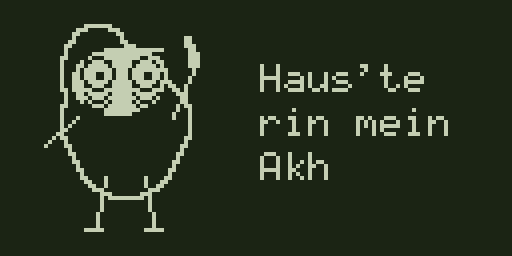

# Blechy: ein Durchgang von 0 bis 100 Prozent, höchstens 20 FPS

Stand 19.10.2026. Die [Übergabe](uebergabe-2026-10-19.yaml) und die anschließende Rückmeldung sind die Grundlage.
Die Gestaltung der Werkbank mit hellem Originalgesicht, festem BLECH und Fußzeile bleibt. Die Bewegung ist
überarbeitet (Rückmeldung 19.10. abends): ein einziger Durchgang. Blechy setzt das Röhrchen an und zieht die Line von
links nach rechts weg. Die Line ist der Balken: wo die Rohrspitze steht, steht der Ladestand. Im festen Startbild
guckt er dich an, beim Ziehen hat er die Augen zu, bei 100 % reißt er sie auf (große Pupillen). Oben mittig
BLECHTRIBE als ein Wort (Impact 22, `blechtribe-titel.png`). Unten im Startbild "FEINSTES GELUMPE" und
"KUHLER_BUHLER", beim Laden links der Status ("LADE SAMPLES...", "FERTIG") und rechts die Prozentzahl. Die Line liegt
auf dem Tisch und hat Buckel (1 bis 2 Pixel). Dahinter fallen ein paar Sterne wie im Hintergrund der App
(`site/design/bg.js`): drei Tiefen, langsam, ab und zu kurz aus; im festen Startbild stehen sie.

**Die Vorgabe lautet höchstens 20 Bilder pro Sekunde** (Rückmeldung 20.10.: ein Pixel braucht am Gerät grob
50 ms, bis er weg ist). Jeder Bildzustand bleibt mindestens 50 ms sichtbar. Das gilt auch für kurze Zwischenbilder, Prozentänderungen und den letzten Zustand
vor der Wiederholung. Eine bloß niedrige Durchschnittsrate reicht nicht. Der Export weist kürzere Zeiten zurück.

Noch kein Firmware-Patch. Die [Vergleichsseite](vergleich.html) zeigt die aktuelle Bewegung und die beiden
früheren Layoutstudien in den Farben und Schriften der App, auch in nativen 128 × 64 Pixeln.

## Ansehen

### Ganzer Ladevorgang, höchstens 20 FPS


Die Demo zeigt den einen Durchgang mit 53 Bildern über 4,7 Sekunden. Die Beispieldauer verlängert keinen
Gerätestart: Der echte Lader darf jederzeit zum aktuellen Fortschritt oder zum fertigen Hauptbild springen.

### Ablauf

| Schritt | Haltung | Haltezeit |
|---|---|---:|
| Startbild | volle Line, Röhrchen abgesetzt, guckt dich an | 800 ms |
| Ansetzen | Kopf zwei Pixel tiefer, Augen zu | 100 ms |
| Ziehen | Rohr auf der Line, Blechy rückt pixelweise nach rechts, bis 48 | 49 × 50 ms |
| Fertig | Line weg, Augen auf mit großen Pupillen, "FERTIG", 100 % | 100 + 1200 ms |

`werkbank-loop*.gif` zeigt denselben Durchgang, damit die Vergleichsseite ihre Plätze behält.
`werkbank-prozent.gif` zeigt jeden Prozentwert von 0 bis 99 als eigenes Bild (je 200 ms), so wie `pass_state()`
ihn am Gerät zeichnen würde. Blechy rückt dabei alle 2 bis 3 % um einen Pixel weiter.

### Abschied im selben Zeitlimit



Blechy winkt, „Haus'te / rin mein / Akh“, dann zieht sich das Bild zur Röhre zusammen und geht aus. Zwei
Winkhaltungen, gestauchtes Bild, kurzer Lichtstrich und Schwarz ergeben fünf Zustände zu je 200 ms. Damit bleibt
auch dieser Ablauf unter der FPS-Grenze und passt weiterhin in das vorhandene 1000-ms-Fenster. Die zusätzlichen
1400 ms Schwarz im GIF sind nur eine Pause zum wiederholten Anschauen.

## Warum die Bewegung jetzt anders wirkt

**Blechy beugt sich an einem festen Ort.** Der Körper bleibt bei derselben X-Position. Der Kopf geht in einzelnen
Pixelschritten höchstens drei Pixel nach unten und wieder zurück. Die linke Hand hält ihre festen Pixel auf dem
Tisch. Die gesamte Figuren- und Armzeichnung endet oberhalb der Tischkante; Fußzeile und BLECH bleiben frei.
Der Fortschritt verschiebt den Körper (`shift`, 0 bis 48 in 4-Pixel-Schritten), sonst nichts.

**Die Hand hält ein starres Röhrchen.** In der Werkbank beträgt sein Vektor 12 × 9 Pixel, also 15 Pixel Länge.
In der tiefsten Pose liegen Nase bei `(37, 44)` und Rohrspitze bei `(49, 53)` exakt auf der Materialhöhe. Der
Griff bleibt bei 63 Prozent der Achse; beide Armstücke bleiben neun Pixel lang. Absetzen verschiebt das ganze
Rohr mit der Hand. Es gibt weder eine wachsende Nase noch ein länger werdendes Rohr.

**Die Line ist der Balken.** Sie liegt bei y 53 von x 49 bis 97. Beim Ziehen fehlt alles links der Rohrspitze
(`eaten`). Bei einem hängenden Lader bleibt das Bild stehen.

**Das Originalgesicht bleibt erhalten.** Gesicht, Augenabstand, Augenringe und Braue stammen aus den vorhandenen
56×56-Sprites. Gesicht hell, Pupillen dunkel, eine Lichtkante von einem Pixel um den dunklen Körper. Die
Originaldateien werden nur gelesen. Die sechs Pupillenstufen folgen dem Fortschritt, ohne Zittern.

## Neu erzeugen

Python 3.10 oder neuer und Pillow genügen. Keine macOS-Schrift erforderlich: `blech-titel.png` wird nur gelesen.
Die kleinen Schriften kommen weiter aus `render.py` und `data/script/font.mjs`.

```bash
python3 entwuerfe/design-1.3/geraet/anim.py
python3 entwuerfe/design-1.3/geraet/anim.py --direction werkbank
python3 entwuerfe/design-1.3/geraet/anim.py --palette mono --output /tmp/blechy-review
python3 -B entwuerfe/design-1.3/geraet/test_anim.py -v
```

| Ausgabe | Inhalt |
|---|---|
| `vorschau/neu/werkbank.gif` | Ganzer Beispiel-Ladevorgang, 4×, höchstens 20 FPS |
| `vorschau/neu/werkbank-prozent.gif` | Jeder Prozentwert ein Bild, 200 ms je Bild |
| `vorschau/neu/werkbank.gif`, `werkbank-loop.gif` | Identische Dateien unter den allgemeinen Vorschau-Namen |
| `vorschau/neu/<name>-1x.gif` | Dieselbe Folge in nativen 128×64 Pixeln |
| `vorschau/neu/<name>-strip.png` | Fünf ausgewählte Schlüsselbilder zum Vergleichen, keine Begrenzung der Animation |
| `vorschau/neu/<name>-start.png`, `-mitte.png`, `-ende.png` | LCD-Standbilder |
| `png/neu/<name>/000.png` und folgende | Alle nativen 1-Bit-Einzelbilder; Schwarz bedeutet sichtbar dunkel |
| `png/neu/<name>-start.png`, `-mitte.png`, `-ende.png` | Native 1-Bit-Schlüsselbilder |
| [manifest.json](vorschau/neu/manifest.json) | Zeiten, Zustände, minimale Haltezeit, maximale Aktualisierungsrate und Pixeländerungen |

Die nummerierten Einzelbilder und optionalen BIN-Dateien werden neu erzeugt und nicht versioniert. Der Export
entfernt dabei nur seine eigenen nummerierten Bilder der jeweiligen Folge, damit keine alten Restframes bleiben.
GIFs, Ablaufstreifen und Schlüsselbilder liegen direkt im Repo.

Die Vergleichsseite lässt sich direkt als Datei öffnen. Alternativ im Repo `python3 -m http.server 8742`
starten und `http://127.0.0.1:8742/entwuerfe/design-1.3/geraet/vergleich.html` aufrufen. Die neue Bewegung startet
automatisch. „Animation aus“ zeigt ausdrücklich ein festes PNG, keine pausierte GIF-Zeitposition. Die
Geräte-Vorgabe für reduzierte Bewegung ist die begrenzte Bildrate; sie bedeutet hier kein automatisches Standbild.

## Echten Fortschritt anschließen

`render_frame(direction, progress, pose=..., started=..., done=..., shift=..., eaten=...)` erzeugt ein neues
Pillow-Bild ohne Uhr, Zufall oder Dateiausgabe. `pass_state(progress, done)` liefert den Zustand zum Ladestand.
Verpasste Zeitpunkte werden übersprungen; es gibt keine nachzuholende Bilderschlange.

Der spätere Display-Aufrufer muss **alle** Bildänderungen gemeinsam auf mindestens 50 ms Abstand begrenzen,
auch neue Prozentzahlen oder Pupillen. Die reine Renderfunktion enthält absichtlich keine Wartezeit. Ein
möglicher Aufruf sieht so aus; `now_ms`, `last_draw_ms` und die Laderdaten gehören dem Aufrufer:

```python
if now_ms - last_draw_ms >= MIN_FRAME_MS:
    st = pass_state(progress, loader_done)
    frame = render_frame("werkbank", progress, pose=st.pose, shift=st.shift,
                         eaten=st.eaten, done=loader_done)
    last_draw_ms = now_ms
    # frame an den Display-Aufrufer geben
```

Ohne `done=True` erscheinen höchstens 99 Prozent und es bleibt Material übrig. Mit `done=True` ist sofort die
fertige Pose ausgewählt, unabhängig von der gerade laufenden Bewegung. Beim Einbauen muss der Aufrufer bei
Fehler oder Abschluss die Überlagerung freigeben. Die sieben Sekunden in `demo_timeline()` sind ausschließlich
ein Beispiel zum Anschauen.

### Zwei Bitreihenfolgen und Display-Invert

Mit `--pack` werden drei Schlüsselbilder je Richtung in beiden vertikalen Bitreihenfolgen geschrieben. Zusätzlich
enthalten `werkbank-loop-msb.bin` und `werkbank-loop-lsb.bin` die sieben Bewegungsschritte in Reihenfolge,
jeweils 7 × 1024 Byte einschließlich der wiederverwendeten Bilder. Das sind Prüfdaten, keine Firmware-Patches.

```bash
python3 entwuerfe/design-1.3/geraet/anim.py --pack --controller-inverted
```

| Format | Byte | Bit |
|---|---|---|
| `*-msb.bin`, wie `assets/blechy/splash.bin` | `(y // 8) * 128 + x` | `0x80 >> (y & 7)` |
| `*-lsb.bin`, wie der Anzeigepuffer | `(y // 8) * 128 + x` | `1 << (y & 7)` |

Ein Bild hat genau 1024 Byte. Der Renderer denkt in sichtbaren Pixeln, der Export rechnet
`RAM-Bit = sichtbar-dunkel XOR controller_inverted`. Bei `DISPLAY INVERT` mit Controllerkommando A7 werden die
Bits deshalb genau einmal komplementiert. Der Default der vorhandenen Firmware wird durch das Rendern nicht
umgestellt.

## Geprüft und noch offen

**Aus den erzeugten Bildern abgeleitet:**

| Folge | GIF-Bilder | Unterschiedliche Raster | Kürzeste Haltezeit | Bildwechsel höchstens |
|---|---:|---:|---:|---:|
| Werkbank, Ladedemo | 53 | 53 | 50 ms | 20 pro Sekunde |
| Ausschalten, ohne GIF-Wiederholungspause | 5 | 5 | 200 ms | 5 pro Sekunde |

Ein Bildwechsel schaltet höchstens 567 Pixel auf höchstens sechs LCD-Seiten. Messen am Gerät steht aus.

Die 19 gezielten Python-Prüfungen sichern unter anderem tatsächliche GIF-Haltezeiten, pixelgenaue Ausgabe in
1×/4×, feste Bildbereiche, fehlenden Körperversatz durch Fortschritt, Rohr- und Griffgeometrie, beide Bitordnungen,
Controllerinvertierung und das 1000-ms-Ausschaltfenster. Der zuvor zu schnelle 100-/120-ms-Ablauf fällt durch
diese Prüfungen. Auch ein einzelnes Bild von 199 ms wird unabhängig von der Durchschnittsrate zurückgewiesen.

**Offen:** die gestalterische Freigabe, Nachziehen des echten LCDs, ARM-Befehle pro Bild, Startzeit und Speicherplatz.
Die frühere Zahl von ungefähr 6300 ARM-Befehlen pro Bild ist eine
[Messung des vorigen Lade-Patches](../../../docs/messungen/2026-10-15-ladebalken.md), keine Messung dieses Renderers.
Fünf vollständige unterschiedliche Loop-Bilder benötigen ohne Kompression 5120 Byte; die gesamte Ladedemo ist
keine sinnvolle Firmware-Bildtabelle. Später sollten Grundbild, Augen, Material und wenige wiederverwendete Posen
zusammengesetzt und im Emulator gemessen werden. Die Größenabschätzungen im Manifest enthalten keinen ARM-Code.

## Frühere Layoutstudien

[Typenschild](vorschau/neu/typenschild.gif) und [Prägung](vorschau/neu/praegung.gif) bleiben als Vergleich der
Aufteilung erhalten. Sie sind keine neuen Bewegungsvorschläge. Auch diese Folgen halten länger als 200 ms pro
Bild. Die unveränderte alte [Rotzen-Referenz](vorschau/rotzen.gif) liegt außerhalb der neuen Exporte.

Für die Designarbeit fehlt aus der Übergabe nichts. Eigene Firmware und Hardwaremessungen sind erst für den
späteren Integrationsschritt erforderlich.
